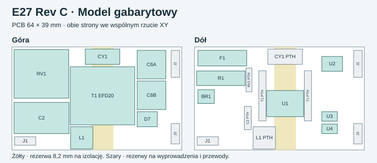

# E27 Rev C · studium zasilacza o niższym profilu

**Decyzja do następnego prototypu.** Zachować regulację wtórną LYT6073C i niezależne odcięcie TPS26600, a pierwsze próbki niższego transformatora oprzeć na EFD20. Plik KiCad pokazuje rozmieszczenie największych obudów i rezerw na wyprowadzenia. Ma kontur i warstwy rysunkowe, bez padów, miedzi i połączeń. W edytorze PCB włączyć osobno warstwę `F.Fab` dla góry i `B.Fab` dla dołu. Pas rezerwy izolacyjnej znajduje się na `Dwgs.User`.

[Otwórz model w KiCad](E27_RevC_Gabaryty.kicad_pcb) · [Specyfikacja transformatora do zapytania ofertowego](RFQ_T1_EFD20.md)

## Gabaryty i ograniczenia montażu

- Obrys modelu wynosi **64 × 39 mm**. Budżet wysokości wynosi **18,95 mm** (12,0 mm od góry, laminat 1,6 mm i 5,35 mm od dołu). T1 ma rezerwę **24,3 × 22 × 10,5 mm**, a C2 i RV1 są położone płasko. Rezerwy obejmują orientacyjne formowanie wyprowadzeń, ale rzeczywiste wygięcia, podparcie, lutowanie i swobodę odpowietrzania C2 wymagają weryfikacji na próbce. W modelu sprawdzono brak nachodzenia 27 obrysów i ich położenie wewnątrz PCB. [Gabaryty TDK EFD20](https://www.tdk-electronics.tdk.com/inf/80/db/fer/efd_20_10_7.pdf) · [Rysunek RV1 Littelfuse](https://www.littelfuse.com/assetdocs/varistors-tmov-datasheet?assetguid=bd475732-1071-4352-b8aa-f78b0007eb05)
- Zastąpić C6 parą **Nichicon UCD1H221MNL1GS**, po 220 µF/50 V, z katalogowym korpusem Ø10 × 10 mm, trwałością 5000 h przy 105°C i prądem tętnień 0,70 A na sztukę przy 100 kHz. Dwa kondensatory dają 440 µF nominalnie i 352 µF przy −20%. Zmierzyć rozdział tętnień, temperaturę i odpowiedź na zmianę obciążenia. Wysokość w modelu wynosi 10,5 mm. [Nichicon UCD](https://www.nichicon.com/en-us/part/ucd1h221mnl1gs/2243/)
- Wymiary odpowiadają próbie zmniejszenia **wysokości**. Rzut ma około 11% większą powierzchnię od Rev B. Obecny model przekracza wszystkie trzy wymiary celu **38 × 17 × 15 mm**. Sam katalogowy obrys EFD20 ma 22 mm szerokości. Z kolei przeniesienie F1 z dołu na górę obniżyłoby teoretyczny budżet do ok. 16,3 mm, jeżeli po drugiej stronie zostałby najwyżej U1 o obwiedni 2,65 mm. Tego wariantu jeszcze nie rozplanowano.
- Pas 8,2 mm na rysunku rezerwuje miejsce pod izolację PCB. Jego szerokość jest założeniem projektowym. Po doborze karkasu trzeba zweryfikować miedź, wyprowadzenia, rdzeń, obejmę i przewody oraz pokazać odstępy na przekroju z korpusem. Model pomija drobnicę, radiator, przegrodę, wiązki, miejsca mocowania i tolerancje całego zespołu. Do wydania pozostaje pełny projekt elektryczny i trasowanie.

## Dlaczego nie przenieść referencji ST wprost

EVLHVLED815W8CV jest izolowanym flybackiem z regulacją po pierwotnej. ST podaje 200–265 VAC, 25 V ±5%, do 310 mA i trzy kondensatory 330 µF/35 V na wyjściu. Dolna granica 23,75 V jest poniżej przyjętych **25,3 V**, potrzebnych do utrzymania prądu w zimnym wkładzie. Gdyby przestroić układ z zachowaniem ±5%, wartość nominalna musiałaby być jednocześnie **≥26,63 V** ze względu na wkład i **≤26,12 V** ze względu na minimalny próg OVP 27,43 V. Już w statyce zakresy się rozchodzą. Wynik można zmienić przez dokładniejszą regulację lub przez potwierdzenie niższego zapotrzebowania na napięcie na rzeczywistych wkładach. [ST EVLHVLED815W8CV, schemat i tabela 1](https://www.st.com/resource/en/data_brief/evlhvled815w8cv.pdf)

Usunięcie kondensatora szyny sieciowej przenosi buforowanie energii 100 Hz na wyjście. Dla idealnego PF = 1, mocy stałej 6,604 W, 50 Hz i całego okna 25,3–27,43 V potrzeba co najmniej **374 µF efektywnej pojemności**. Wzór to C = 2P / [2πf × (Vmax² − Vmin²)], wynikający z całki różnicy mocy chwilowej i średniej. Uwzględnia wyłącznie bilans energii. Para 220 µF po skrajnej tolerancji daje 352 µF, a więc nie wystarcza w tym wariancie nawet przy idealnej regulacji. W wybranym wariancie z LYT zostaje C2 na szynie sieciowej.

## Kolejność dalszej walidacji

1. Zmierzyć minimalne napięcie regulacji obu kanałów z trzema barwami, na zimno i po nagrzaniu, według planu Rev B. Wynik zastąpi budżet 25,3 V i pozwoli ocenić, czy PSR ma wystarczające okno.
2. Wykonać obojętną elektrycznie makietę rozmieszczenia oraz próbkę formowanych C2/RV1. Zmierzyć grubość i interferencję z przegrodą oraz radiatorami. Zmierzyć temperaturę C2, gdy leży blisko PCB i zabezpieczeń.
3. Po potwierdzeniu wykonalności karkasu zmierzyć na próbkach T1 indukcyjność, przekładnię, fazę, upływ i nasycenie na gorąco. Następnie zweryfikować VDS, szczyt prądu, moc i temperatury na osłoniętym stanowisku po przeglądzie elektrycznym. Dopiero po tych wynikach przenieść T1 i zmienione obudowy do elektrycznej rewizji.
