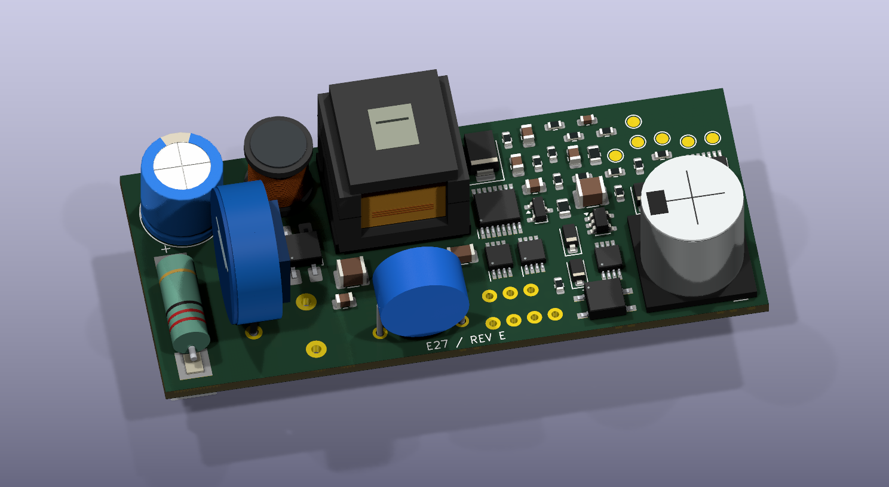

# Velluneo E27 · Rev E · studium gabarytów zasilacza

Dwa układy rozmieszczenia wykonane w KiCad na podstawie elektrycznej Rev D. Oba zachowują wartości i połączenia oryginalnych elementów. [Rev D 96 × 34 mm z plikami do wyceny JLCPCB](../Zasilacz_RevD_JLCPCB/README.md) pozostaje jako punkt odniesienia i wersja rezerwowa.

## Jedna płytka

**74 × 32 mm**, czyli ok. **27% mniej powierzchni** niż Rev D. Wszystkie 93 obrysy, łącznie z punktami testowymi, zmieściły się na dwóch stronach z tymi samymi obudowami. Pas pomiędzy padami sieci pierwotnych i wtórnych w rzucie na oś X ma **8,2 mm**. Pole miedzi odprowadzające ciepło trzeba zaprojektować ponownie wraz ze ścieżkami. [Płytka w KiCad](E_Jedna.kicad_pcb)

## Dwie płytki

- **57 × 32 mm, moc.** Wejście 230 V, przetwornica i transformator, prostownik wtórny D7 oraz kondensator wyjściowy C6. D7 i C6 pozostają na tej samej płytce co transformator. J101 wyprowadza S_RAW i S_RTN za układem pomiaru prądu. Pas między padami P/S wynosi 8,2 mm. [Płytka mocy w KiCad](E_Moc.kicad_pcb) · [Podgląd 3D](Podglady/RevE_plytka_mocy.png)
- **30 × 26 mm, sterowanie.** J102 przyjmuje wyłącznie wtórne 26 V i jego powrót. Na tej płytce są eFuse, dwa regulatory prądu, pomiar K1/K2, zatrzask zwarciowy, blokady i punkty testowe. J101/J102 mają zgodne przypisanie: pad 1 S_RAW, pad 2 S_RTN. Docelowy przewód i jego odciążenie wymagają projektu wraz z korpusem. [Płytka sterowania w KiCad](E_Sterowanie.kicad_pcb) · [Podgląd 3D](Podglady/RevE_plytka_sterowania.png)

Podział skraca najdłuższą płytkę o 17 mm względem wariantu jednopłytkowego. Łączna powierzchnia laminatu to 2604 mm² wobec 2368 mm² jednej płytki, czyli około 10% więcej. Zyskiem jest możliwość niezależnego rozmieszczenia części mocy i sterowania. Przy ułożeniu warstwowym trzeba sprawdzić odstęp pomiędzy sieciowymi obszarami i płytką sterowania w trzech wymiarach, przestrzeń na wiązkę i chłodzenie. Wycena wymagałaby dwóch projektów PCB, a dwustronne obsadzenie każdego obrysu osobnej weryfikacji panelu. [JLCPCB PCBA](https://jlcpcb.com/capabilities/pcb-assembly-capabilities)

## Co ogranicza zejście do 38 × 17 × 15 mm

Przyjęty transformator EE16 ma obwiednię montażową ok. 17,2 × 16,2 mm. W zachowanej orientacji i z 0,75 mm rezerwy od krawędzi po obu stronach sam potrzebuje około 17,7 mm szerokości. Poza transformatorem trzeba zmieścić obudowy po obu stronach bariery i zapewnić miejsce na bezpieczne prowadzenie ścieżek. Pionowo ustawiony warystor TMOV14 może wymagać do 22 mm nad PCB przy prostych wyprowadzeniach. Zmniejszanie obrysu z tym samym zestawem części nie rozwiązuje wysokości. [Obwiednia T1](E27.pretty/EE16_6pins_RFQ.kicad_mod) · [Wymiary TMOV, str. 6](https://www.littelfuse.com/assetdocs/varistors-tmov-datasheet?assetguid=bd475732-1071-4352-b8aa-f78b0007eb05)

Przy sztywnym celu 38 × 17 × 15 mm kolejny krok to wstępny dobór węższego i niższego transformatora wraz z izolacją oraz sprawdzenie ułożenia warystora i kondensatorów. Rozmieszczenie płytki mocy zależy od tych danych. Jeżeli korpus daje dwie oddzielne przestrzenie, punktem wyjścia do tej próby jest wariant z dwiema płytkami. Na makietach nie wykonano trasowania, wypełnień cieplnych, pomiarów ani eksportu do zamówienia. [Kontrola rozmieszczenia i przypisań pinów](Kontrola_RevE.md)

## Podglądy 3D

Poprzednie modele niestandardowych obudów w Rev D były prostymi bryłami zastępczymi. Dodałem własne modele do podglądu, z kształtem korpusów i wyprowadzeń. Obejmują m.in. warystor, kondensator Y1, dławik, kondensator SMD, bezpiecznik, mostek prostowniczy i układy scalone. Model transformatora odwzorowuje przyjętą obwiednię i układ sześciu wyprowadzeń, a wygląd rdzenia i uzwojenia pozostaje orientacyjny do wyboru dostawcy. Modele i materiały służą do wizualizacji. Do sprawdzenia mechaniki obowiązują rysunki wymiarowe i próbki komponentów. [Nichicon C6](https://www.nichicon.com/en-us/part/ucm1h471mnj1ms/2563/) · [Würth L1](https://www.we-online.com/components/products/datasheet/768772102.pdf) · [Vishay CY1](https://www.vishay.com/docs/23102/440lseries.pdf) · [Podgląd na stronie JLCPCB](https://jlcpcb.com/blog/kicad-mcp-how-to-design-a-pcb-with-claude-code)

[Rev D z nowymi modelami od góry](Podglady/RevD_nowe_modele_gora.png) · [Rev D od spodu](Podglady/RevD_nowe_modele_dol.png)

Z katalogu `hardware/E27` polecenie `work/export_reve.ps1` odtwarza modele 3D, podglądy i raporty. Opcja `-Rebuild` odtwarza również rozmieszczenie z pliku Rev D.
