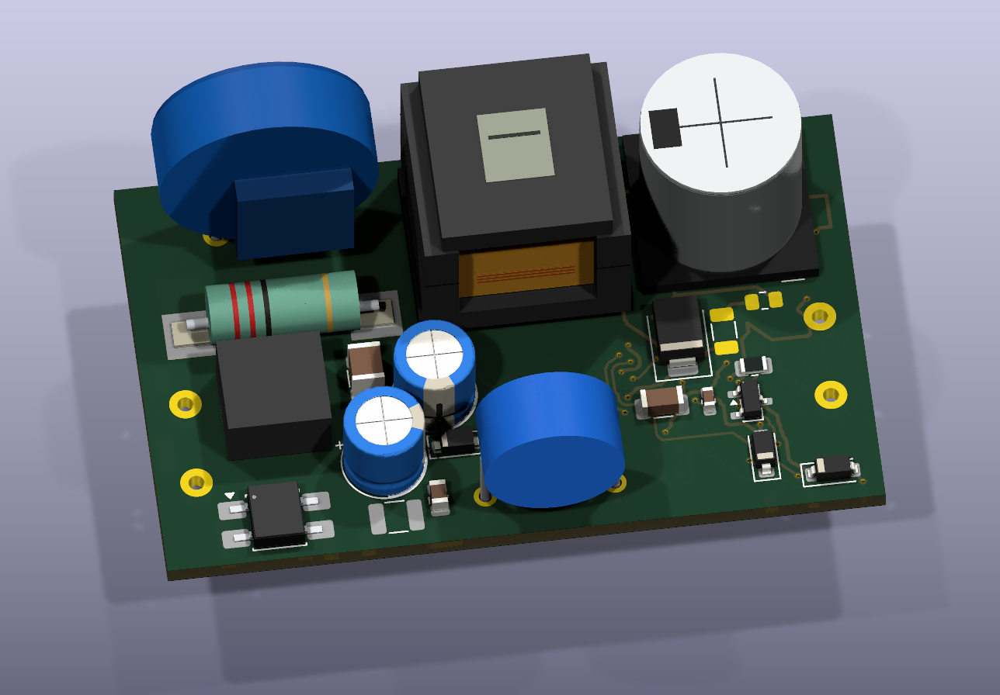

# Velluneo E27 · Rev J · studium valley-fill

Studium korekcji prądu wejściowego rozwija [płytkę mocy Rev H](../Zasilacz_RevH_Moc/README.md). Zachowuje nominalną szynę 26 V dla [sterowania Rev G](../Zasilacz_RevG_Sterowanie/README.md) oraz obrys **55,5 × 34 mm**. Przedmiotem etapu jest schemat, dobór kandydatów i rozmieszczenie.

[Projekt KiCad](Zasilacz_RevJ_Studium.kicad_pro) · [Schemat](Zasilacz_RevJ_Studium.kicad_sch) · [Podgląd schematu](Podglady/Zasilacz_RevJ_Studium.svg) · [PCB rozmieszczenia](Zasilacz_RevJ_Studium.kicad_pcb) · [Kontrola KiCad](DRC_rozmieszczenia.rpt)

- C2 i C17 to kondensatory 3,3 µF / 400 V, Ø6,3 × 12 mm z rozstawem wyprowadzeń 2,5 mm. Ładują się szeregowo przez D10 i R24/R25. Przy spadku napięcia wejściowego rozładowują się równolegle przez D11 i D12. R26 i R27 rozładowują osobno kondensatory. W rozmieszczeniu wykorzystano mniejszą obudowę L1 oraz przesunięto C1 i R5. [AISHI C2990968](https://www.lcsc.com/product-detail/C2990968.html) · [NRVUS1MFA C889715](https://jlcpcb.com/partdetail/onsemi-NRVUS1MFA/C889715) · [Rezystory 1 MΩ C706459](https://jlcpcb.com/partdetail/YAGEO-RV1206FR071ML/C706459)
- Wstępny ogranicznik ładowania to dwa rezystory 91 Ω w 2512. Idealny przypadek załączenia przy szczycie 253 VAC i dwóch pojemnościach po 3,96 µF daje prąd rzędu 1,7 A oraz około 0,056 J na rezystor w obwodzie z dodatkową rezystancją szeregową 26 Ω. Wymagany jest przegląd krzywej impulsowej wybranego MPN i powtarzanych startów. [TT Electronics HDSC](https://www.ttelectronics.com/TTElectronics/media/ProductFiles/Datasheet/HDSC.pdf)
- C18 ma wstępnie 150 nF / 630 V, a C19 jest polem pod dodatkową pojemność do prób. W przypadku 0,12 µF efektywnie model daje przy 230 VAC PF co najmniej 0,86 i THDi do ok. 51%. Pojemność i położenie C18 trzeba dopasować wspólnie do impulsów flyback oraz harmonicznych. [Model i założenia](../Zasilacz_RevH_Moc/Studium_valley_fill.md)
- L1 768775312 jest kandydatem na dławik 1,2 mH. Model korpusu odpowiada gabarytom rodziny 7850. Geometria padów w studium jest wstępna i wymaga sprawdzenia z rysunkiem montażowym producenta. [Würth 768775312](https://www.we-online.com/components/products/datasheet/768775312.pdf)

Kontrola rozmieszczenia wykazuje **0 naruszeń geometrii i 0 rozbieżności ze schematem**. Porównano 125 przypisań pin–sieć dla 53 footprintów. Połączenia po stronie wtórnej pochodzą z Rev H. Raport wykazuje **54 miejsca oczekujące na trasowanie strony sieciowej**. Na następnym etapie trzeba w pierwszej kolejności ułożyć pętlę T1–U1–C18, obwód ogranicznika RCD i powrót prądu diod valley-fill. Pakiety Gerber do wyceny są w Rev H i Rev G.

