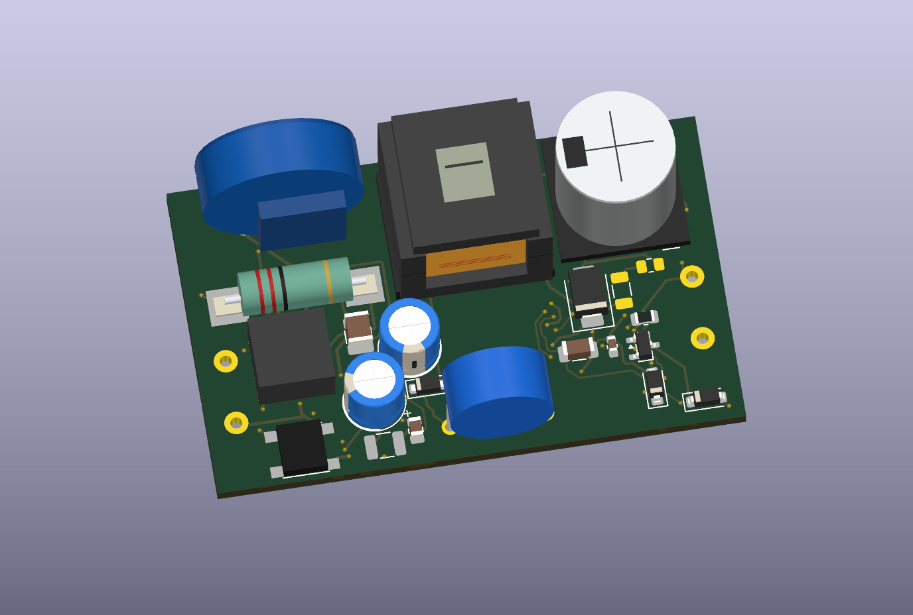

# Velluneo E27 · Rev L · płytka mocy valley-fill

Czterowarstwowe studium o obrysie **55,5 × 34 mm** rozwija [Rev J](../Studium_RevJ_ValleyFill/README.md). Wyjście 26 V jest zgodne ze [sterowaniem Rev H](../Zasilacz_RevH_Sterowanie/README.md). Do wyceny bieżącego prototypu służy [para Rev K i Rev H](../../Pakiet_prototypu_JLCPCB.md).

[Projekt KiCad](Zasilacz_RevL_Studium.kicad_pro) · [PCB](Zasilacz_RevL_Studium.kicad_pcb) · [Schemat](Zasilacz_RevL_Studium.kicad_sch) · [Rysunek schematu](Podglady/Zasilacz_RevL_Studium.svg)

- Mostek ABS10M-13 przejęto z Rev K. C17 ma pola Ø1,35 mm, otwory Ø0,80 mm i raster 2,50 mm. Odstęp między jego padami wynosi 1,15 mm. Zastosowano regułę 1,10 mm pomiędzy powrotem pierwotnym a węzłami valley-fill. Rozstaw wyprowadzeń i dopasowanie elementu potwierdzić na próbkach. [Dane mostka](https://www.diodes.com/datasheet/download/ABS10M.pdf) · [Katalog AiSHi](https://www.aishi.com/files/3_AiSHi_Full_Catalog.pdf)
- Próba dwuwarstwowa pozostawiła trzy połączenia. W Rev L warstwa In1.Cu zawiera jednolite pole powrotu P_0 o powierzchni **531,7 mm²**. Warstwa In2.Cu obsługuje połączenia strony pierwotnej, a prześwit między projekcjami skrajnej miedzi wynosi 8,20 mm.
- Obrót C2 i zmiana trasowania skróciły trasę do D11 z 20,16 do 15,57 mm i wyeliminował sześć zmian warstwy na tym odcinku. W zamian droga od C18 do T1 ma 17,11 mm i jedną zmianę warstwy. Odcinek T1–U1 po stronie drenu ma 4,59 mm, a powrót U1–C18 ma 8,63 mm. Długości mierzono po osi ścieżek, bez uwzględnienia przewodzenia przez pole In1.Cu.
- Po ponownym wypełnieniu pola KiCad zgłasza **0 naruszeń ERC i DRC, 0 niepołączonych padów i 0 rozbieżności PCB ze schematem**. Osobno sprawdzono 125 przypisań pin–sieć. [ERC](ERC.rpt) · [DRC](DRC.rpt)

Przed przygotowaniem pakietu prototypowego Rev L trzeba potwierdzić dostępność elementów wejścia i montaż otworowy C17. Na prototypie należy zmierzyć przebiegi na C18 i drenie oraz temperatury D10–D12 i R24/R25. Weryfikacja harmonicznych dotyczy kompletnego zespołu i wymaga pomiaru. [Założenia modelu](../Zasilacz_RevH_Moc/Studium_valley_fill.md)

