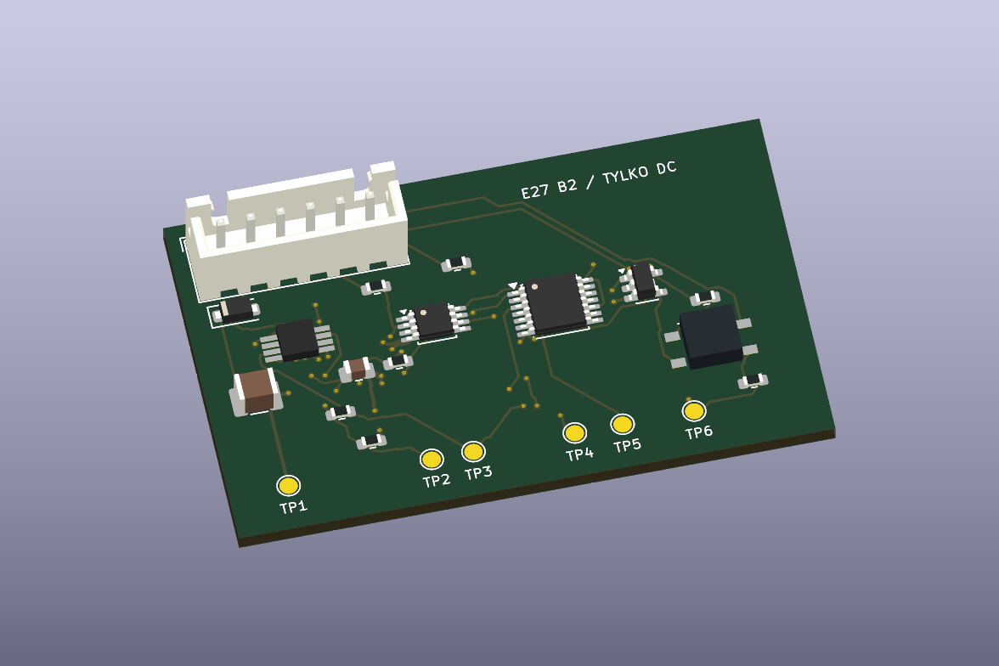

# E27 · Rev B2 · moduł prób ochrony zwarciowej

Moduł **50 × 30 mm** do badań części wtórnej zasilacza Rev B1 z izolowanego źródła **18–30 V DC**. Dwa detektory mierzą napięcie na regulatorach prądu. Po wykryciu nadmiernego spadku na jednym z nich przerzutnik utrzymuje blokadę obu kanałów, dopóki układ pomocniczy jest zasilany. Moduł włącza się w powrót S1/TH1 do SHDN.

[Projekt KiCad](Zasilacz_RevB2_Ochrona.kicad_pro) · [Schemat](Zasilacz_RevB2_Ochrona.kicad_sch) · [PCB](Zasilacz_RevB2_Ochrona.kicad_pcb) · [BOM](BOM_RevB2.csv) · [Pliki do przeglądu](Produkcja_DO_PRZEGLADU)

[Schemat do podglądu](Podglady/Zasilacz_RevB2_Ochrona.svg) · [Spód PCB](Podglady/RevB2_dol_3D.png)

## 1. Problem i próg

Przy zwarciu obciążenia AL5812 może nadal ograniczać prąd do około 127 mA. Przy 26 V na regulatorze oznacza to w pierwszej chwili **około 3,3 W**, podczas gdy prąd całego zasilacza może pozostać poniżej progu nadprądowego eFuse. Napięcie K1 lub K2 względem S_RTN odpowiada spadkowi na odpowiednim AL5812, więc mierzymy je niezależnie od prądu eFuse. [Diodes AL5812](https://www.diodes.com/datasheet/download/AL5812.pdf) · [TI TPS26600](https://www.ti.com/lit/ds/symlink/tps2660.pdf)

TLV1702 porównuje napięcie z dzielników 330 kΩ / 22 kΩ z odniesieniem z 3,3 V przez 133 kΩ / 22 kΩ. Kondensatory 220 nF dają około **4,54 ms** nominalnej stałej czasowej. W modelu przyjęto ±27% efektywnej pojemności. Próg nominalny na K1/K2 to **7,49 V**, a model narożnikowy daje **7,15–7,85 V**. Uwzględniono ±2% szyny, ±0,35% osobno dla każdego rezystora, ±5,5 mV offsetu i prądy polaryzacji komparatorów. Tolerancja rezystorów obejmuje ±0,1% początkowo i ±25 ppm/K dla przyjętej zmiany temperatury o 100 K. Dla badanego punktu 26,4 V z obciążeniem 20 V pozostaje około 0,75 V do najniższego obliczonego progu, przed tętnieniami. [TI TLV1702](https://www.ti.com/lit/ds/symlink/tlv1702.pdf) · [TI TPS7A16](https://www.ti.com/lit/ds/symlink/tps7a16.pdf) · [Panasonic ERA 133 kΩ](https://industrial.panasonic.com/ww/products/pt/high-precision-chip-resistors/models/ERA3AEB1333V)

## 2. Sekwencja i współpraca z Rev B1

- TPS7A1633 zasila układ i wystawia sygnał PG po opóźnieniu, typowo około 12 ms dla 10 nF. Zbocze zegara przerzutnika SN74HCS74 jest dodatkowo opóźnione przez RC. PG przez D1 oraz wyjścia komparatora mogą wymusić niski CLR_N. PG i wyjście PERMIT wspólnie sterują PhotoMOS przez bramkę Schmitta. Przed pierwszym załączeniem weryfikować poziomy PG, CLK, CLR_N oraz stan PhotoMOS na wolnych i szybkich rampach. [TI TPS7A16](https://www.ti.com/lit/ds/symlink/tps7a16.pdf) · [TI SN74HCS74](https://www.ti.com/lit/ds/symlink/sn74hcs74.pdf) · [TI SN74LVC1G132](https://www.ti.com/lit/ds/symlink/sn74lvc1g132.pdf)
- Po zdarzeniu niskie CLR_N zeruje PERMIT. Powrót K1/K2 do normalnych wartości ani ponowne zamknięcie S1 nie daje nowego zbocza CLK. Odcięcie utrzymuje się do resetu PG. Głęboki zanik szyny, po którym PG ponownie wzrośnie, może sam ponownie uzbroić układ. To zachowanie jest jawnie objęte próbą.
- PhotoMOS otwiera powrót S1/TH1. Na Rev B1 rezystor R18 ściąga SHDN w dół. R12 modułu dodaje 100 kΩ do istniejących R17/R18, po 10 kΩ, co daje **około 2,17 V** przy 26 V oraz **1,50–2,50 V** przy 18–30 V w modelu bez prądu wejścia SHDN. Bez R12 sam dzielnik daje ok. 13 V przy 26 V. Zalecany zakres wejścia według TI to 0–4 V. Sprawdzić rzeczywiste napięcia oraz pracę styków S1 przy zmniejszonym prądzie. [TI TPS26600, zalecane warunki pracy i opis SHDN](https://www.ti.com/lit/ds/symlink/tps2660.pdf)

### Wiązka J1

1. **S_RAW** z regulowanej szyny przed eFuse.
2. **S_RTN** z masy wtórnej eFuse i regulatorów.
3. **K1** z wyjścia pierwszego regulatora.
4. **K2** z wyjścia drugiego regulatora.
5. **S1_RETURN** z powrotu zamkniętej pętli S1/TH1. Odłączyć ją uprzednio od J2-2.
6. **S_EN** do J2-2 Rev B1. R17 i R18 w tym zestawie mają wartości z Rev B1. S2 i istniejące zabezpieczenie OVP pracują w swoich dotychczasowych torach.

Punkty TP1–TP6 oznaczają odpowiednio S_RTN, 3,3 V, PG, CLR_N, PERMIT i SHDN. Pomiar CLK można wykonać na C8. D3 jest diodą od wyjścia LDO do odseparowanego przez D2 wejścia LDO, która ogranicza napięcie wsteczne przy zaniku. Przy próbach zaniku sprawdzić również (V_{OUT}-V_{IN}) U1 przy rzeczywistych pojemnościach i temperaturze. Dla C2 10 µF dobrać egzemplarz o pojemności efektywnej co najmniej 2,2 µF przy polaryzacji 3,3 V i skrajnej temperaturze. [TI TPS7A16](https://www.ti.com/lit/ds/symlink/tps7a16.pdf) · [TDK C1](https://product.tdk.com/en/search/capacitor/ceramic/mlcc/info?part_no=C3225X7R2A225K230AB)

## 3. Model i wynik kontroli

- Model RC przewiduje decyzję komparatora po **1,06–2,08 ms** dla idealnego skoku 0→26 V i **4,14–8,88 ms** dla 0→10 V. Czas odłączenia prądu obejmuje dodatkowo PhotoMOS, TPS26600 i rozładowanie pojemności. Panasonic podaje do 0,5 ms wyłączenia AQY212GS w swoich warunkach 25°C, z prądem wejścia 5 mA i obciążeniem 100 mA. W pętli SHDN warunki są inne. [Panasonic AQY212GS](https://industry.panasonic.com/ac/cdn/e/control/relay/photomos/catalog/semi_eng_gu1a_aqy21_gs.pdf)
- [Wyniki 18 przypadków modelowych](Model_RevB2_przypadki.csv) obejmują dwa narożniki, zwarcia osobno na K1 i K2, zwarcie przy włączeniu, impulsy, otwartą pętlę S1 i ponowne uzbrojenie po utracie PG. Wydłużenie filtra z początkowych 47 nF do 220 nF pozwoliło w obu badanych narożnikach odrzucić pojedynczy impuls 100 µs do 26 V przy początkowych 6,4 V na kanale. Impuls 500 µs w tych samych warunkach wyzwolił odcięcie. Model stanów pomija fizykę półprzewodników, opóźnienie TPS26600 i termikę.
- [Raport ERC](ERC.rpt) i [raport DRC z porównaniem schematu](DRC.rpt) wykazały zero naruszeń oraz zero niepołączonych padów. Dodatkowe sprawdzenie porównało 102 przypisania pin–sieć w generatorze, schemacie i PCB, 31 pozycji BOM i 30 pozycji montażu SMD. Nie wykonano prób fizycznych.

## 4. Próby na stanowisku DC

1. Uruchomić moduł samodzielnie, bez strony sieciowej i bez zasilania obciążenia. Zmierzyć 3,3 V, VREF, PG, CLK i CLR_N na zimnym oraz nagrzanym module. Zmierzyć upływ PhotoMOS oraz potwierdzić otwarcie między pinami 5 i 6 przy braku zasilania. Zbadać szybkie i wolne narastanie oraz zapady, także w okolicy dolnych granic pracy logiki.
2. Podać na K1 i K2 oddzielnie kontrolowaną rampę względem S_RTN. Potwierdzić próg, czas od skoku do CLR_N i utrzymanie blokady po usunięciu przyczyny. Przy skokach mierzyć też czas otwarcia PhotoMOS i odcięcia prądu przez eFuse. Próby powtórzyć przy obu kanałach oraz przy rozłączaniu S1 i S2.
3. Połączyć z częścią wtórną Rev B1 zasilaną z izolowanego źródła 26 V z ograniczeniem prądu. Rozpocząć od dwóch obciążeń zastępczych. Zmierzyć SHDN w obu stanach, minimalny spadek na obciążeniu i prąd obu kanałów. Dopiero potem przejść do osobnych zwarć o ograniczonej energii, początkowo krótkich. Rejestrować A+, K1, K2, CLR_N, SHDN oraz prąd i temperaturę regulatorów.
4. Sprawdzić temperaturę przy częściowym zwarciu poniżej progu. Przykładowo 7 V na regulatorze odpowiada około 0,9 W przy 127 mA. Sprawdzić brak przewodu pomiarowego, przekaźnik pozostający w zwarciu oraz spadek i powrót PG. Sam przerwany przewód pomiarowy pozostawia kanał bez detekcji nadmiernego napięcia.

Moduł jest osobną płytką laboratoryjną, ze stratą LDO szacowaną na około 0,22 W przy 26 V i załączonym PhotoMOS. Po pomiarach można ocenić, ile z układu trzeba przenieść na główną płytkę i czy pobór prądu jest akceptowalny.

Do odtworzenia etapu służy `work/export_b2.ps1` uruchamiany z katalogu `hardware/E27`. Zapisuje projekt, wyniki modelu, kontrole i eksporty KiCad.
