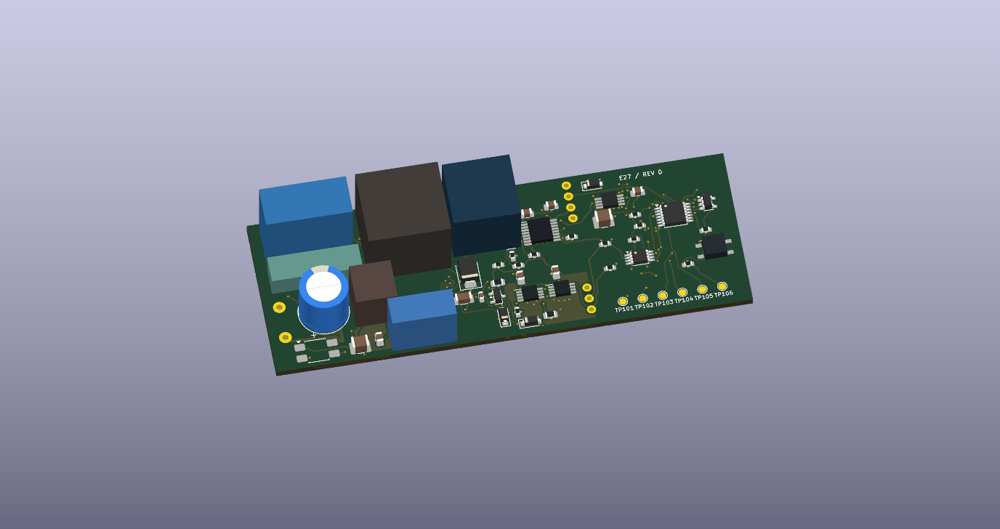

# Velluneo E27 · zasilacz Rev D · JLCPCB

Rev D zawiera na **jednej płytce 96 × 34 mm** zasilacz sieciowy, dwa regulatory prądu, zabezpieczenie eFuse oraz układ wykrywający zwarcie w dowolnym kanale. Oba etapy wyceny dotyczą tej samej płytki. To prototyp elektryczny. Obrys wydłużyłem z 66 do 96 mm, żeby zachować sprawdzone w KiCad rozmieszczenie przetwornicy i jej pola miedzi. Docelowa przestrzeń zasilacza to ok. 38 × 17 × 15 mm. Dopasowanie do wnętrza żarówki wymaga miniaturyzacji i ponownej weryfikacji izolacji oraz chłodzenia.

[Projekt KiCad](Zasilacz_RevD_JLCPCB.kicad_pro) · [Schemat KiCad](Zasilacz_RevD_JLCPCB.kicad_sch) · [PCB KiCad](Zasilacz_RevD_JLCPCB.kicad_pcb) · [Schemat do podglądu](Podglady/Zasilacz_RevD_JLCPCB.svg) · [Spód PCB](Podglady/RevD_dol_3D.png)

## Wycenienie PCB i montażu w JLCPCB

1. **Samo PCB.** Prześlij [RevD_Gerber_JLCPCB.zip](RevD_Gerber_JLCPCB.zip). Wybierz standardowe FR-4, dwie warstwy, 1,6 mm, 1 oz miedzi, zieloną maskę, białe opisy i ENIG. Pakiet zawiera obrys, warstwy miedzi, maski, pasty, opisów i wiercenia PTH. Potwierdź w podglądzie obrys 96 × 34 mm i położenie otworów. Przelotki mają otwór 0,30 mm. Zamówienie z testem elektrycznym PCB sprawdza połączenia gołej płytki. [Możliwości wykonania PCB](https://jlcpcb.com/capabilities/pcb-) · [Wymiary PCB](https://jlcpcb.com/help/article/pcb-dimensions)
2. **Montaż na tej samej płytce.** Prześlij ten sam Gerber i wybierz montaż dwustronny **Standard PCBA**. Katalog podaje minimum 70 × 70 mm dla pojedynczej płytki lub panelu oraz wymaga szyn technologicznych i znaczników pozycjonujących. Wybierz **Panel by JLCPCB**. Proponowany układ do wyceny to X = 1, Y = 2, z dwiema szynami 5 mm równoległymi do długiej krawędzi. Przy rozdzielaniu V-cut daje to około 96 × 78 mm. Poproś JLCPCB o potwierdzenie szyn, orientacji panelu, sposobu rozdzielenia i podglądu dwóch stron dla tego układu. Przesłany BOM/CPL opisuje pojedynczą płytkę, którą powiela JLCPCB. [Możliwości montażu](https://jlcpcb.com/capabilities/pcb-assembly-capabilities) · [Panelizacja](https://jlcpcb.com/help/article/pcb-panelization) · [Zamawianie panelu](https://jlcpcb.com/help/article/how-do-i-order-a-panel)
3. **Pliki montażowe.** Zaimportuj [BOM JLCPCB](JLCPCB_PCBA_DO_WYCENY/BOM_JLCPCB.csv) i [CPL JLCPCB](JLCPCB_PCBA_DO_WYCENY/CPL_JLCPCB.csv) razem. To podzbiór pozycji z dopasowanymi kodami katalogowymi. Pozycja z kodem LCSC może wymagać odrębnego zakupu, nawet gdy kod rozpoznaje importer. Potwierdź ilość w magazynie montażowym, obudowy, stronę oraz pin 1 każdego układu i polaryzację diod oraz C6 w podglądzie przed akceptacją. Aktualnego zapasu, orientacji w maszynie i akceptacji panelu nie zweryfikowano w koszyku JLCPCB. [Format BOM i CPL dla KiCad](https://jlcpcb.com/help/article/how-to-generate-the-bom-and-centroid-file-from-kicad)
4. **Domknięcie obsadzenia.** [Pełny BOM](BOM_pelny_RevD.csv) wymienia każdą pozycję montażową. [Pozycje poza importem](JLCPCB_PCBA_DO_WYCENY/Pozycje_poza_importem.csv) wskazują elementy do potwierdzenia w katalogu, dostawy własnej lub montażu oddzielnego. [Pełny CPL 79 SMD](CPL_pelny_79_SMD.csv) to plik referencyjny do uzupełnienia importu. Po potwierdzeniu kolejnych części BOM i CPL przekazywane fabryce muszą mieć ten sam zestaw oznaczeń. Dla części zewnętrznych można sprawdzić Global Sourcing lub dostarczenie własnych części po potwierdzeniu obsługi i zapasu montażowego. T1 wymaga osobnej wyceny uzwojenia. Przewody J1/J2/J3 lutuje się po obsadzeniu. Ceny prototypu i serii pozostają do wyceny dla aktualnej liczby sztuk. [Pozyskiwanie części do PCBA](https://jlcpcb.com/help/article/pcba-parts-sourcing-instruction) · [Dostawa własnych części](https://jlcpcb.com/help/article/how-to-consign-parts-to-jlcpcb)

## Połączenia i odprowadzanie ciepła

- Detektory U102 mierzą S_LED_KA i S_LED_KB bezpośrednio na PCB. Przerzutnik U103 utrzymuje blokadę po przekroczeniu progu. PhotoMOS U105 rozłącza powrót pętli S1/TH1 na J2-2. R112 = 100 kΩ daje obliczeniowo ok. 2,17 V na SHDN przy szynie 26 V i załączonej pętli. Po głębokim zaniku szyny PG może ponownie uzbroić zabezpieczenie. [Model i założenia detektora](../Zasilacz_RevB2_Ochrona/README.md)
- Z Rev B1 pozostały cztery pola termiczne na dwóch stronach PCB i 12 przelotek cieplnych, które łączą miedź pod sterownikiem flyback i regulatorami prądu. Pomiar temperatur powinien objąć także nowe źródła strat, w tym LDO U101. [Pola termiczne Rev B1](../Zasilacz_RevB1/Weryfikacja_KiCad_RevB1.md)
- Punkty TP101–TP106 to kolejno S_RTN, 3,3 V, PG, CLR_N, PERMIT i SHDN. CLK jest dostępny na C108. [Weryfikacja plików](Weryfikacja_RevD.md) · [ERC](ERC.rpt) · [DRC i zgodność ze schematem](DRC.rpt)

## Transformator i uruchomienie prototypu

Do wyceny T1 należy przekazać [kartę EE16 z §3 Rev A](../Raport_E27_RevA.md#3-schemat-zasilacza-i-zadanie-dla-dostawcy-transformatora) oraz aktualny [rysunek padów T1 z Rev D](E27.pretty/EE16_6pins_RFQ.kicad_mod). Założenia elektryczne to EE16/EE1621, Ae ≥ 33,8 mm², Lp 1,2 mH ±8%, uzwojenia 84:23:13 w kolejności pierwotne, wtórne, pomocnicze. Początki uzwojeń są na pinach 2, 6 i 4. Dostawca ma potwierdzić rysunek karkasu i wyprowadzeń, biegunowość, izolację, parametry prądowe w temperaturze oraz indukcyjność rozproszenia. Przed obsadzeniem sprawdzić pasowanie próbki do padów.

1. Na pierwszym egzemplarzu zasilić wyłącznie szynę wtórną z izolowanego i ograniczonego prądowo źródła DC. Sprawdzić dwa progi, czasy odłączenia, blokady S1/S2, zachowanie przy zapadach i prąd pętli SHDN.
2. Przed próbami 230 V sprawdzić T1, F1 i R1, elementy granicy izolacji oraz stanowisko. Próby przy sieci wykonać na stanowisku do układów sieciowych według [planu badań](../Plan_prob_RevB.md), rozszerzonego o zwarcie K1/K2, pomiary temperatur U101 oraz zachowanie po zaniku PG.
3. Zgoda na serię wymaga pomiarów temperatur i zwarć, weryfikacji izolacji kompletnego zespołu oraz potwierdzenia doboru części i montażu. Wyniki KiCad dotyczą plików projektu. Rev D nie przeszła jeszcze prób na fizycznej płytce.

Projekt powstał w KiCad 10 przy użyciu lokalnych skryptów i narzędzia eksportu KiCad. Weryfikacja obejmuje osobne porównanie pinów, jak w opisanym przez JLCPCB procesie. [Artykuł JLCPCB o projektowaniu w KiCad](https://jlcpcb.com/blog/kicad-mcp-how-to-design-a-pcb-with-claude-code)

Regeneracja z gotowych plików KiCad z katalogu `hardware/E27` poleceniem `work/export_revd.ps1`. Opcja `-Rebuild` odtwarza również projekt z rewizji B1/B2.
