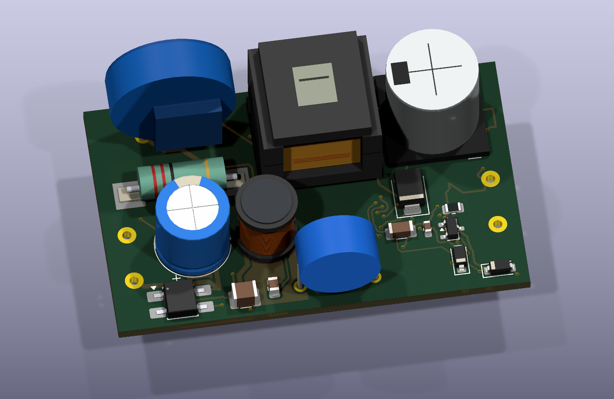

# Velluneo E27 · Rev G · płytka mocy

Rev G jest aktualnym wariantem rozwojowym strony sieciowej. Współpracuje z [płytką sterowania Rev F](../Zasilacz_RevF_Sterowanie/README.md). J101-1 prowadzi nominalne 26 V, J101-2 to S_RTN. Format płytki mocy pozostaje **55,5 × 34 mm** na dwóch warstwach. [Rev F mocy](../Zasilacz_RevF_Moc/README.md) zachowano do porównań.

[Projekt KiCad](Zasilacz_RevG_Moc.kicad_pro) · [PCB](Zasilacz_RevG_Moc.kicad_pcb) · [Schemat](Zasilacz_RevG_Moc.kicad_sch) · [Podgląd schematu](Podglady/Zasilacz_RevG_Moc.svg) · [Pełna lista części](BOM_RevG.csv)

- Zmieniono obwód D5/C3/R4 ograniczający przepięcia na kluczu przetwornicy. C3 to 2,2 nF C0G 630 V, D5 to US1M 1000 V, a R4 i R22 tworzą 164 kΩ szeregowo. Miedź strony wtórnej i złącze J101 pozostały jak w Rev F. [Analiza przepięć i strat](Analiza_RCD.md)
- Sprawdzenie KiCad wykazało 0 naruszeń, 0 niepołączonych padów i 0 rozbieżności ze schematem. Najwęższy pas w projekcji X między miedzią stron wynosi **8,2 mm**. [Weryfikacja płytki](Weryfikacja_RevG.md)
- [Pliki do wyceny technologicznej JLCPCB](JLCPCB_DO_WYCENY) obejmują Gerbery, wiercenia, dopasowane BOM/CPL i pozycje poza importem. Dla montażu Standard ustalić osobne panele dla płytek mocy i sterowania oraz sposób obsadzenia THT, w szczególności transformatora. Dostępność i orientacje części potwierdza import w portalu. [Wymagania JLCPCB](https://jlcpcb.com/capabilities/pcb-assembly-capabilities)

Przed zwolnieniem do serii obowiązują kwalifikacja T1, pomiary obwodu RCD i temperatur, przegląd izolacji kompletnego zasilacza oraz próby EMC. [Dane próbek T1](RFQ_T1_EE16.md)

