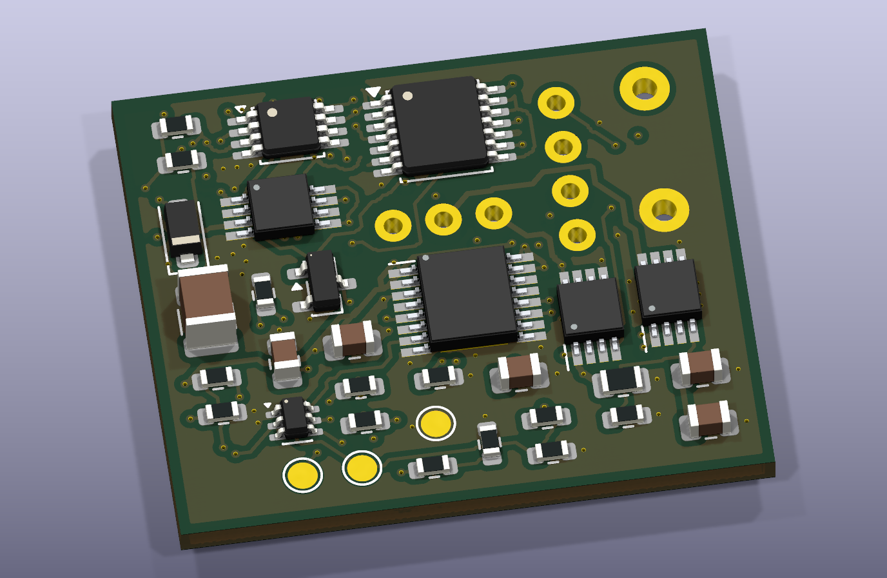

# Velluneo E27 · Rev G · płytka sterowania

Płytka sterowania Rev G tworzy zasilacz z [płytką mocy Rev G](../Zasilacz_RevG_Moc/README.md). Obrys wynosi **30 × 25 mm**. J102-1 to S_RAW, a J102-2 to S_RTN. Schemat i lista części odpowiadają [sterowaniu Rev F](../Zasilacz_RevF_Sterowanie/README.md), wraz z niezależnym odcięciem kanałów, blokadą po awarii, eFuse i wejściami zabezpieczeń.

[Projekt KiCad](Zasilacz_RevG_Sterowanie.kicad_pro) · [PCB](Zasilacz_RevG_Sterowanie.kicad_pcb) · [Schemat](Zasilacz_RevG_Sterowanie.kicad_sch) · [Rysunek schematu](Podglady/Zasilacz_RevG_Sterowanie.svg) · [BOM](BOM_RevG.csv) · [Gerbery i pliki do wyceny JLCPCB](JLCPCB_DO_WYCENY)

## Przewodzenie ciepła do miedzi

- Przy polach termicznych regulatorów U3/U4 dodano **pięć przelotek** S_RTN, trzy przy U3 i dwie przy U4. Mają pola Ø0,45 mm, otwory Ø0,20 mm i przykrycie maską po obu stronach. Dwie dotychczasowe przelotki powiększono do pola Ø0,55 mm i otworu Ø0,25 mm. Otwory są poza padami lutowniczymi.
- Wszystkie siedem sprawdzonych przelotek łączy pola powrotu na F.Cu, In1.Cu i B.Cu. Pole In1.Cu nadal tworzy jeden obszar ok. **574 mm²**. Wokół U4 ścieżki sygnałowe wydłużają drogę cieplną przez miedź do dwóch nowych przelotek. Wpływ na temperaturę trzeba sprawdzić oddzielnie dla obu regulatorów.
- Położenia i obroty części oraz wszystkie ścieżki są zgodne z Rev F. Porównano 148 przypisań pin–sieć. Kontrola KiCad wykazała 0 naruszeń i 0 niepołączonych padów. [ERC](ERC.rpt) · [DRC](DRC.rpt) · [Model zabezpieczeń Rev F](../Zasilacz_RevF_Sterowanie/Model_RevF.csv)
- Pakiet do wyceny zawiera 45 pozycji SMT. Wiązki do trzech złączy wymagają oddzielnego uzgodnienia. Przy wycenie sprawdzić stos warstw, możliwość tentowania przelotek i panel montażowy. [Możliwości PCB JLCPCB](https://jlcpcb.com/capabilities/pcb-capabilities/) · [Możliwości montażu JLCPCB](https://jlcpcb.com/capabilities/pcb-assembly-capabilities)

## Pomiar cieplny

Zasilać część wtórną z izolowanego źródła 26 V z ograniczeniem prądu i użyć dwóch regulowanych obciążeń zastępczych. Przy ok. 127 mA i napięciu obciążenia 20, 22 oraz 24 V szacowane straty wynoszą ok. 0,78, 0,52 i 0,27 W na regulator wraz z uproszczonym poborem własnym. Zmierzyć napięcie między pinem LED a masą oraz prąd każdego kanału i przeliczyć rzeczywiste straty.

Porównać temperatury obudów U3/U4 i sąsiedniej miedzi przy obu kanałach obciążonych, przy 25°C i 40°C, do stanu ustalonego. Zmiana poniżej 1°C przez 10 minut jest roboczym kryterium stabilizacji. Wartość 90°C/W z karty AL5812 dotyczy płytki producenta. Do oszacowania temperatury złącza potrzebne są warunki pomiaru i model odpowiadający rzeczywistej płytce. [Karta AL5812](https://www.diodes.com/datasheet/download/AL5812.pdf) · [Plan wcześniejszej próby cieplnej](../Zasilacz_RevB1/README.md)

