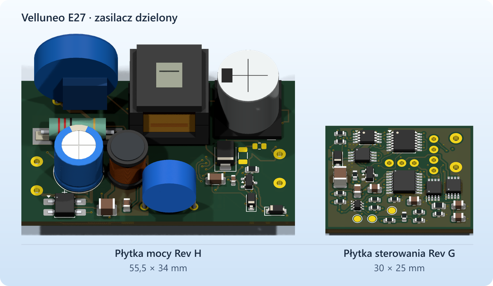

# Velluneo E27 · Rev H · płytka mocy

Płytka mocy ma **55,5 × 34 mm** i współpracuje ze [sterowaniem Rev G](../Zasilacz_RevG_Sterowanie/README.md) o obrysie 30 × 25 mm. J101-1 to nominalne 26 V, J101-2 to S_RTN. [Płytka mocy Rev G](../Zasilacz_RevG_Moc/README.md) pozostaje zapisem poprzedniego etapu.

[Projekt KiCad](Zasilacz_RevH_Moc.kicad_pro) · [PCB](Zasilacz_RevH_Moc.kicad_pcb) · [Schemat](Zasilacz_RevH_Moc.kicad_sch) · [Rysunek schematu](Podglady/Zasilacz_RevH_Moc.svg) · [Pełna lista części](BOM_RevH.csv)

- C16 i R23 to miejsca do ręcznego dostrojenia tłumienia oscylacji przy diodzie D7. Obie pozycje są domyślnie puste. Pola mają miedź i otwarcie maski, a w szablonie pasty pozostają zamknięte. [Dobór i próba RC](Tlumienie_D7.md)
- Ogranicznik pierwotny RCD z Rev G pozostaje w projekcie. Docelowe rozproszenie T1 wynosi maks. 10 µH, a dla tego przypadku obwiednia obliczeniowa szczytu drenu wynosi 565,6 V. [Analiza RCD](../Zasilacz_RevG_Moc/Analiza_RCD.md) · [Dane próbek transformatora](../Zasilacz_RevG_Moc/RFQ_T1_EE16.md)
- W porównaniu z Rev G do importu montażowego dodano pięć pozycji katalogowych. Wyszczególniono wyprowadzenia, części wymagające ręcznego montażu oraz pozycje do oddzielnej wyceny. [Dobór części i montaż](Montaż_JLCPCB.md)
- Obie płytki przeszły kontrole KiCad. Pomiary napięć, temperatur, izolacji i EMC przewidziano na pierwsze egzemplarze. [Weryfikacja Rev H](Weryfikacja_RevH.md) · [Pakiet mocy do wyceny JLCPCB](JLCPCB_DO_WYCENY)

