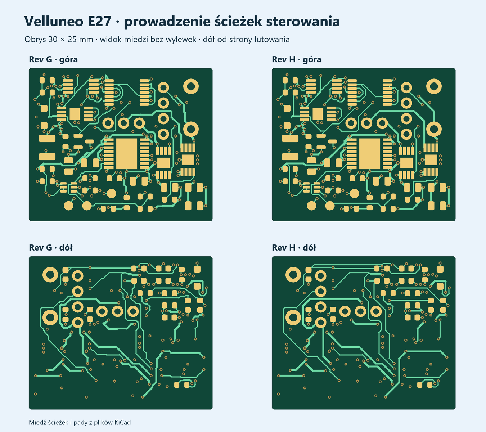

# Velluneo E27 · Rev H · płytka sterowania

Sterowanie do izolowanej szyny 26 V ma obrys **30 × 25 mm** i cztery warstwy. J102-1 to S_RAW, J102-2 to S_RTN. Schemat zachowuje dwa kanały prądowe, eFuse i blokady z [Rev G](../Zasilacz_RevG_Sterowanie/README.md).

[Projekt KiCad](Zasilacz_RevH_Sterowanie.kicad_pro) · [PCB](Zasilacz_RevH_Sterowanie.kicad_pcb) · [Schemat](Zasilacz_RevH_Sterowanie.kicad_sch) · [Rysunek schematu](Podglady/Zasilacz_RevH_Sterowanie.svg) · [Lista części](BOM_RevH.csv) · [Gerber, BOM i CPL dla prototypu](JLCPCB_DO_WYCENY)

- Dłuższe odcinki prowadzą ścieżki na wprost oraz pod 45°. Liczba segmentów spadła z 1573 do 1008, a segmentów krótszych niż 0,2 mm z 759 do 391. Łączna długość spadła z 959,75 do 945,34 mm. Przy padach i przelotkach część krótkich odcinków nadal zapewnia dojście w ciasnej geometrii.
- Porównano 148 przypisań pin–sieć. Położenia elementów i 121 przelotek są takie jak w Rev G. Pole powrotu In1.Cu jest jednym obszarem o powierzchni 573,6 mm². Sieć REF ma 25,0 mm ścieżek. Sprawdzono połączenie siedmiu przelotek przy U3 i U4 z polami powrotu.
- KiCad wykazał **0 błędów ERC, 0 naruszeń DRC, 0 niepołączonych padów i 0 rozbieżności PCB ze schematem**. [ERC](ERC.rpt) · [DRC](DRC.rpt) · [Raport wierceń](Wiercenia.rpt)
- Pakiet zawiera 45 pozycji SMT. Trzy przyłącza przewodów są wyszczególnione poza importem. Do dwustronnego montażu Standard obrys 30 × 25 mm wymaga panelu z szynami i fiducjalami. Przy składaniu zapytania o prototyp potwierdzić panel i dostępność części. [Możliwości PCB JLCPCB](https://jlcpcb.com/capabilities/pcb-capabilities/) · [Montaż JLCPCB](https://jlcpcb.com/capabilities/pcb-assembly-capabilities)
- Próba pierwszych sztuk obejmuje prąd obu kanałów, działanie blokady po awarii i temperatury U3/U4 przy zasilaniu z izolowanego źródła 26 V. [Procedura prób z Rev G](../Zasilacz_RevG_Sterowanie/README.md#pomiar-cieplny)

