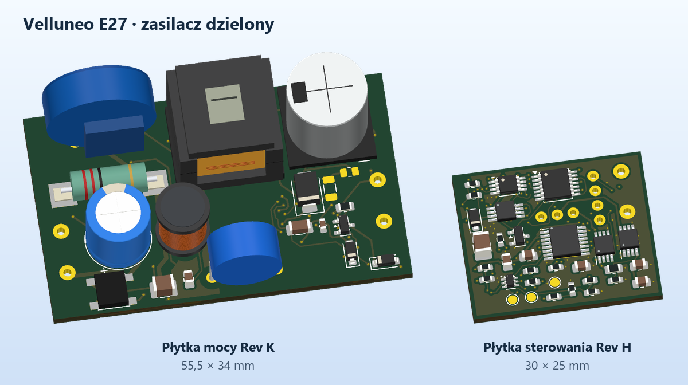

# Velluneo E27 · Rev K · płytka mocy

Płytka mocy ma **55,5 × 34 mm** i dwie warstwy. Z [płytką sterowania Rev H](../Zasilacz_RevH_Sterowanie/README.md) tworzy jeden zasilacz. J101-1 i J102-1 to szyna 26 V S_RAW, a J101-2 i J102-2 to S_RTN. [Poprzednia płytka Rev H](../Zasilacz_RevH_Moc/README.md) pozostaje punktem odniesienia.

[Projekt KiCad](Zasilacz_RevK_Moc.kicad_pro) · [PCB](Zasilacz_RevK_Moc.kicad_pcb) · [Schemat](Zasilacz_RevK_Moc.kicad_sch) · [Rysunek schematu](Podglady/Zasilacz_RevK_Moc.svg) · [Lista części](BOM_RevK.csv) · [Gerber, BOM i CPL dla prototypu](JLCPCB_DO_WYCENY)

## Zmiany

[Porównanie ścieżek mocy przed zmianą i po niej](Podglady/Sciezki_RevH_RevK.png)

- BR1 to Diodes Incorporated **ABS10M-13**, 1000 V, 1 A. Wzór padów SOPA-4 WX ma pola 1,20 × 1,80 mm, raster 4,00 mm wzdłuż rzędu i 5,40 mm między rzędami. Sąsiednie pola mostka mają 2,80 mm odstępu w krytycznej osi. Mapowanie pinów według producenta to 1 (+), 2 (~ N), 3 (−), 4 (~ L). [Rysunek producenta](https://www.diodes.com/datasheet/download/ABS10M.pdf) · [Pozycja JLCPCB C7507234](https://jlcpcb.com/partdetail/DiodesIncorporated-ABS10M13/C7507234)
- Liczba odcinków spadła z **853 do 579**. W obwodach mostka uporządkowano dojścia pod 45°. Zweryfikowano, że ścieżki drenu, szyny P_BULK, ogranicznika RCD oraz przełączanej strony wtórnej zachowały geometrię z Rev H. W miejscach przy padach i przelotkach pozostały krótkie dojścia.
- Przelotki P_0, które naruszały odstępy przy L1/C3, zastąpiły cztery nowe przy U1. Mają pola Ø0,60 mm, otwory Ø0,30 mm i tentowanie z obu stron. Po uwzględnieniu poprawnych reguł pola P_0 mają 54,8 mm² na górze i 40,7 mm² na dole. Wcześniejsze większe powierzchnie Rev H pochodziły z wypełnienia z błędnymi regułami. Pomiar temperatury U1 pozostaje częścią kwalifikacji.
- KiCad wykazał **0 naruszeń DRC, 0 niepołączonych padów, 0 rozbieżności PCB ze schematem oraz 0 naruszeń ERC**. Porównano 105 przypisań pin–sieć. Niezależny pomiar w osi X wykazał **8,20 mm** między skrajną miedzią pierwotną i wtórną na PCB. [DRC](DRC.rpt) · [ERC](ERC.rpt) · [Wiercenia](Wiercenia.rpt)

## Prototyp JLCPCB

- Pakiety Gerber można przekazać do przeglądu technologicznego. Pliki montażowe mocy obejmują **32 pozycje SMT**, 11 na górze i 21 na dole. Sterowanie ma 45 pozycji SMT. W przypadku montażu obu stron w usłudze Standard uzgodnić dwa oddzielne panele, szyny i fiducjale. [Możliwości produkcji PCB](https://jlcpcb.com/capabilities/pcb-capabilities/) · [Możliwości montażu PCBA](https://jlcpcb.com/capabilities/pcb-assembly-capabilities)
- [Lista pozycji poza importem](JLCPCB_DO_WYCENY/Poza_importem.csv) obejmuje m.in. transformator T1, pozycje przewlekane, wiązki, F1/R1 i nieobsadzane C16/R23. Przed zleceniem pełnego montażu ustalić wykonawcę tych operacji oraz dostępność dokładnych MPN. Przy sprawdzaniu podglądu montażu BR1 porównać znacznik pinu 1 z rzeczywistym padem dodatnim.

## Kwalifikacja przed serią

1. Odebrać próbki T1 z rysunkiem wyprowadzeń i wynikami izolacji. Zmierzyć indukcyjność, przekładnię, biegunowość i indukcyjność rozproszenia. Projektowy limit Llk to 10 µH, z warunkami pomiaru opisanymi w RFQ. [Specyfikacja T1](../Zasilacz_RevG_Moc/RFQ_T1_EE16.md)
2. W próbach sieciowych wykonać pomiary przebiegu drenu, prądu włączenia i napięcia C2, odpowiedzi na zmianę obciążenia oraz temperatur U1, T1, D7, R1 i kondensatorów. Oddzielnie sprawdzić oba kanały sterowania z izolowanego zasilacza 26 V. [Analiza RCD](../Zasilacz_RevG_Moc/Analiza_RCD.md) · [Próby wejścia](../Zasilacz_RevH_Moc/Analiza_wejscia.md) · [Próby sterowania](../Zasilacz_RevG_Sterowanie/README.md#pomiar-cieplny)
3. Zmierzyć harmoniczne prądu, EMC i izolację kompletnego zespołu. Model wejścia z kondensatorem 10 µF pokazuje ryzyko wysokich harmonicznych. Wariant valley-fill rozwijany jest oddzielnie w [studium Rev J](../Studium_RevJ_ValleyFill/README.md).

