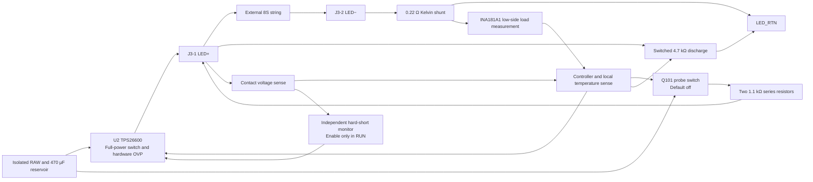

# Two-contact output circuit study

Task E27-8S-TWO-CONTACT-CIRCUIT. Codex owns the circuit sketch, calculation, and footprint-space study. Inputs are the owner's two-contact decision at bc935b55b2f85a12c79dfed9c67fcd73d30a10c8 and the archived D4 board at 00e32cf518c72beb2ce4053b342cb536ba399207. Scope is the secondary output stage and REQ-CC, REQ-CONTACT and REQ-INTEGRATION. Acceptance for this study is an explicit signal/energy path, independently reproducible corner calculations, and a saved-board footprint-space check. The archived D4, insert CAD and mechanics are outside the write scope. This is a block-level study within schematic preparation.

## Secondary output circuit sketch

- Prefer a 60 V P-channel probe switch with a source-referenced gate clamp, level shift and default-off bias. Confirm the semiconductor's SOA, orientation and resistance before capture. Place both probe resistors in series between the switch and contact so a single shorted resistor leaves hardware current limiting. Reserve a hardware pulse timeout independent of the controller. The probe bypasses U2, so it needs an independent hardware voltage bound; current-limiting resistors alone cannot bound open-circuit voltage. Resolve where this cutoff, its valid supply and its single-fault protection sit before committing the probe netlist.
- Keep the load shunt only in J3-2, so the switched discharge does not masquerade as LED load. Proposed U111 INA181A1 gain is 20. At 270 mA and 0.22 Ω this gives 1.19 V with a 59.4 mV load drop. Use a low-side arrangement and characterize near-zero output swing, offset and small currents. Bias REF above ground and budget the bias plus ADC error. Budget the 59 mV drop against cold compliance. [TI INA181](https://www.ti.com/lit/ds/symlink/ina181.pdf)
- Candidate ATtiny404 coordinates the switch commands, voltage and current qualification, and internal thermistor. Run only after the reset and supply are valid. Detect open load with the load-current shunt; hard-short hardware has priority once RUN is validated. Since the contact voltage is intentionally low at power-on into a fault, strictly bound the temporary hardware blanking and main-switch pulse during startup; a faulty controller must not extend it. Retain U2's current protection and independent hardware OVP. Plan watchdog, brownout, reset defaults and programming taps. The footprint study reserves room for most of these blocks; final independent cutoff and blanking parts may add positions. [Microchip ATtiny404](https://www.microchip.com/en-us/product/ATTINY404) · [TI TPS2660](https://www.ti.com/lit/ds/symlink/tps2660.pdf)

## Calculated corner screens

Run `python work/check_8s_two_contact.py` from hardware/E27. The screen uses 26.33–27.07 V RAW, two 1.1 kΩ ±1% series resistors, switched bleed, an illustrative 100 ms sampling point and 125 ms pulse cap, and 0.5 s minimum pause. They are initial computation inputs. Downstream 10 µF is an envelope to test, not the chosen production capacitor.

- At 30 V, the nominal topology limits hard-short current to 13.77 mA at the tolerance corner. With one resistor shorted the remaining resistor limits it to 27.55 mA. Worst-case energy drawn from the source in a 125 ms short probe is 51.7 mJ with both resistors intact; check pulse power with either resistor failed. The maximum resistive-load energy during that same intact probe is 12.9 mJ. These are electrical bounds under the assumed voltage and timeout. They are not touch-current limits or a guarantee that the pulses are safe.
- With the bleeder off, an open 10 µF node reaches about 26.04 V after 100 ms at low RAW. A healthy 8S loaded voltage of 16–23.5 V would yield about 1.27–5.08 mA at steady state, but this LED band is illustrative. A resistor of about 3.29–16.16 kΩ can mimic that band with one probe amplitude. Evaluate two stimulus levels and their voltage change for load discrimination. Test representative resistive and capacitive fixtures, partial shorts, and real LED samples. Full-power operation and touch safety cannot depend on positive identification of the insert by the probe.
- A 4.7 kΩ ±1% discharge path and 10 µF decay from 30 V to 5 V in 85.1 ms after cutoff. That leaves 14.9 ms for detection and switching. Schedule probing after this initial interval following unplug. Turn off the bleeder during probe because it otherwise masks an open load. Make the bleed control default to discharge when independent power behavior permits, and measure its failed-on and failed-off behavior.

## Footprint evidence and handoff

Run `work/preview_8s_two_contact.py` with KiCad 10.0.8 Python. The study retains 61 D4 positions, deletes 33 positions (including J2 and the interlock/latch implementation) and adds 34 footprint reservations. The 95 positions fit on the two-sided 70 × 34 mm board. KiCad 10.0.8 DRC reports zero basic placement violations. All pad nets are deliberately cleared and no tracks are present. DRC therefore provides placement evidence only. The study reuses the D4 library via its local footprint table. No independent schematic-stage review is claimed.

[KiCad footprint study](../../outputs/Zasilacz_8S_D5_Studium/8S-D5-Studium.kicad_pcb) · [3D top](../../outputs/Zasilacz_8S_D5_Studium/8S-D5-top.png) · [DRC report](../../outputs/Zasilacz_8S_D5_Studium/DRC.rpt)

Next, specify the probe overvoltage barrier, hardware timeout and startup blanking circuits. Set a low-current LED identification envelope and evaluate mismatch cases before the whole-board netlist, routing, insulation and qualification.
