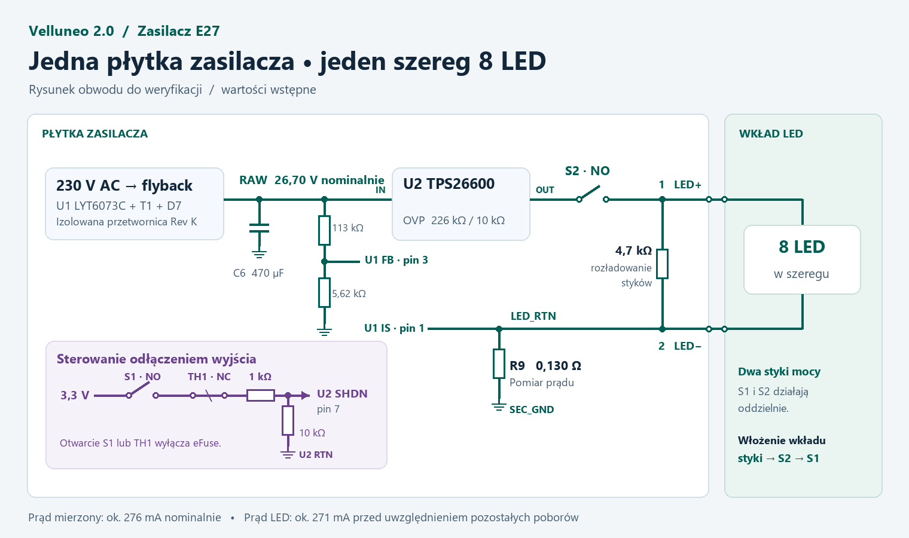

# 8S driver circuit proposal

Task E27-8S-CIRCUIT is owned by Codex. It covers the secondary circuit proposal and the illustrated changed connections for REQ-8S, REQ-CC and OPEN-CC. Base Velluneo commit `3df03011a6ec937e147caa2dde65b2f13af18e29`, requirements intent digest `3cdd9d3acd8b98e729ecd689bb8b76b2e1260cf768094b1bc6902acbba21121f`, toolkit revision as pinned in the [workflow index](../project-index.md). The owned files are this proposal, its preview and the index entry. This is a design input for independent pin-intent review. Role reviews are due on the frozen physical pin-intent packet. The drawing shows circuit architecture and candidate pin groups. KiCad sources, layout and manufacturing data are outside this task. The [schematic stage check](schematic-prep-check.json) remains open.

The [follow-up pin and protection review](driver-pin-review.md) records the corrected D8 polarity and the preferred SHDN reference. The preview above reflects the earlier candidate for those details.

## Power path and pin-intent changes

- Replace the Rev K to Rev H board link with a local RAW and return connection. Start from the Rev K isolated flyback (LYT6073C-TL, T1, D7). Connect RAW to the reservoir C6 positive terminal and eFuse inputs. The C6 negative terminal is at SEC_GND. Keep the nominal 470 µF, 50 V Rev K reservoir for initial analysis. Evaluate a smaller capacitor against ripple, transient energy and thermal results.
- The driver output is J_LED-1 LED+ and J_LED-2 LED−. LED+ is after S2. LED− is the sensed return, designated LED_RTN here and S_RTN in Rev K. Remove the separate AL5812 current paths and second cathode. Review any removal of the previous channel-monitor/latch circuitry against REQ-CC, including open string, shorted string and failed-switch cases. The drawing shows the insert as an external load.
- U1 IS (pin 1) connects to LED_RTN. U1 secondary GND (pin 2) connects to SEC_GND. Use separate Kelvin sense connections to the two sides of R9. Retain D8 as a candidate parallel clamp, anode SEC_GND and cathode LED_RTN. Check peak positive and negative IS excursions. U1 FB (pin 3) connects to the midpoint of 113 kΩ from RAW and 5.62 kΩ to SEC_GND, both 0.1%. Retain the separate nominal ~17 V supply for U1 VO (pin 6). The proposed unloaded CV is 26.70 V nominal, 26.33–27.07 V at the calculated 25°C static corners.
- Start with R9 = 0.130 Ω, 1%, then evaluate 0.137 Ω, 1%. The 0.130 Ω option regulates **total sensed return** to about 276 mA nominal, 268–285 mA at the 25°C static corners. LED current is lower by the bleeder and any other auxiliary current returned to LED_RTN. A 4.7 kΩ bleeder draws about 5.1 mA at 24 V, giving about 271 mA nominal before other auxiliary current. Characterize LED current directly and keep the 285 mA load screen until measured data support a tighter bound. [Power Integrations LYTSwitch-6, pin functions and current sense](https://www.power.com/sites/default/files/documents/lytswitch-6_family_datasheet.pdf)

## Protection and interlocks

- U2 TPS26600PWPR in HTSSOP: tie IN pins 1 and 2 to RAW, OUT pins 15 and 16 to the input side of S2, and connect OVP pin 5 to the 226 kΩ / 10 kΩ divider referenced to eFuse RTN. The eFuse RTN pin is 8, system GND pin 9, and thermal pad 17 connects to eFuse RTN. Keep these as separate named nodes in the proposal. U2 GND connects to LED_RTN and the support parts reference U2 RTN. Rev H tied them together, disabling reverse-input protection. Check RTN-to-GND operating offset and re-evaluate OVP relative to the contacts. The previously calculated 27.54–28.99 V is referenced to U2 RTN and excludes that offset and transients.
- Connect UVLO 3 to U2 RTN for the internal threshold. Use 30.1 kΩ from ILIM 11 to U2 RTN and 47 nF from dVdT 12 to U2 RTN as starting points. Add 402 kΩ from MODE 6 to U2 RTN as a candidate overload-latch configuration. Verify OVP recovery separately. IMON 10 and FLT 14 may remain unused in this candidate. Pins 4 and 13 are no-connects. Retain at least the datasheet-recommended effective local bypass on IN and OUT before S2. Capture actual turn-on peak with C6 precharged. A nominal 470 µF reservoir at 26.70 V stores about 0.17 J. In normal insertion the eFuse must remain off until S2 closes and then ramp under load, and stored energy must also be included in the shorted-eFuse fault review. [TI TPS2660x, pin functions, modes and application guidance](https://www.ti.com/lit/ds/symlink/tps2660.pdf)
- Candidate permit uses the Rev H 3.3 V regulator TPS7A1633DGNR, supplied from RAW and referenced to U2 RTN so SHDN stays within its 0–4 V recommended range. Feed S1 (NO) and TH1 (NC) in series through 1 kΩ to U2 SHDN (pin 7), with a local 10 kΩ pull-down to U2 RTN. The ideal closed level is ~3.0 V. At 0.4 V the pull-down can sink ~40 µA, above the 10 µA datasheet condition. Retain LDO input bypass and verify effective output capacitance ≥2.2 µF. Review supply sequencing and reverse stress at the LDO, contact current, bounce, latch-reset behavior and a regulator fault driving SHDN above its recommended range. In this candidate S1/TH1 inhibits U2 output. The flyback reservoir may remain charged. [TI TPS7A16, pin functions and capacitance](https://www.ti.com/lit/ds/symlink/tps7a16.pdf)
- Keep the logical J2 convention: J2-1 → S1 NO → TH1 NC → J2-2, J2-3 → S2 NO → J2-4. Insertion order is LED contacts mate, S2 closes, S1 permits U2. Removal starts with S1 releasing, followed by S2 opening, before access to contacts. Switch part selection, keying, travel and timings remain to be verified with the housing. Place the candidate 4.7 kΩ ±1%, 0.5 W bleeder across the driver-side contacts after S2. At 30 V it dissipates up to ~0.194 W and nominal discharge is ~85 ms if total contact-side capacitance is ≤10 µF. Verify elapsed time from actual normal opening, including isolation delay and leakage. [Voltage and discharge analysis](output-protection-study.md)

## Review and verification remaining

The preview and this pin-intent proposal are design evidence. They contain no measured or simulated result. Before a native schematic is generated, complete the independent whole-board physical pin graph and resolve the open electrical and interface inputs for its review. The following items are specific to this proposal.

- Check whether the separate eFuse RTN, its internal ground path, and the LDO supply respect all pin limits at start, normal operation and during reverse or fault conditions. Include the reference offset in the 30 V contact limit. Compare contact current and timing with selected S1, TH1 and S2 parts.
- Check the cold string voltage against 26.33 V at the minimum CV corner, including the forward drops, current-sense drop and ripple. The previous 26.10 V screening estimate leaves ~0.23 V static margin before those estimates are refined.
- Verify independence and the complete single-fault matrix, including shorted eFuse, failed SHDN path, feedback failure, S2 stuck closed and sense-clamp bypass. Capture contact peak voltage and discharge. Validate the current pulse into the actual 8S load with a precharged reservoir.
- Verify input/T1 isolation and the final output capacitance separately before the schematic can be accepted. Compare the final fault and control behavior with the removed Rev H circuitry.
