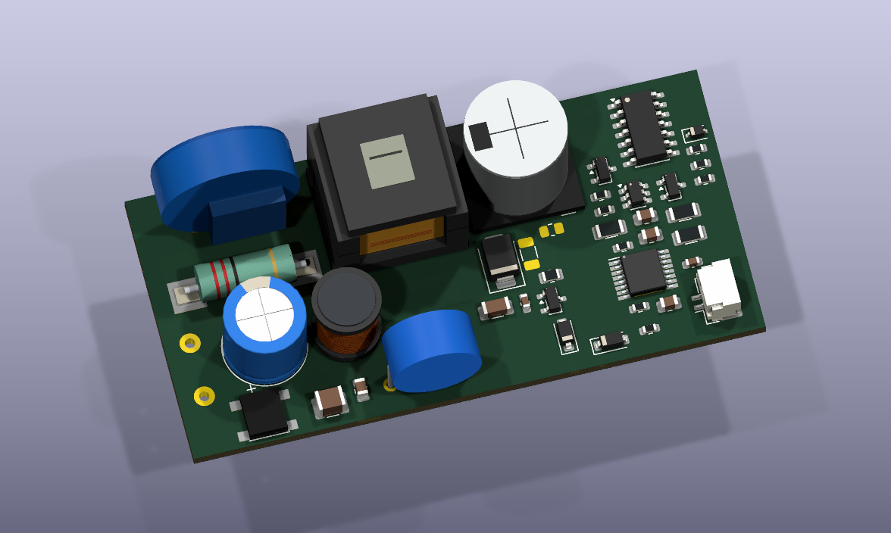
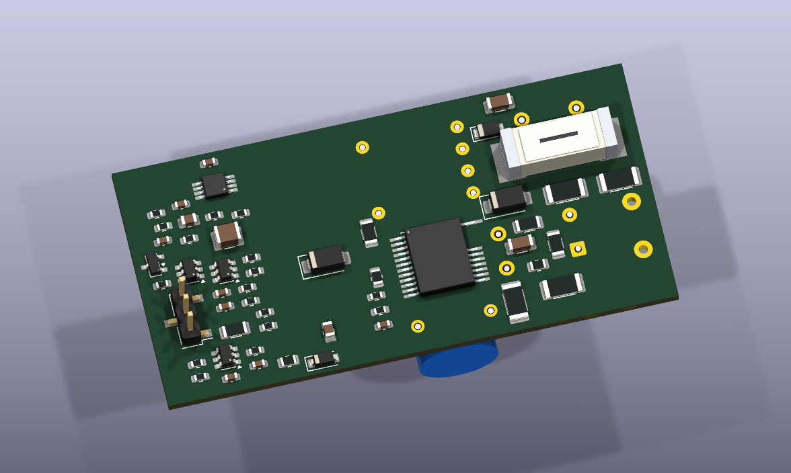
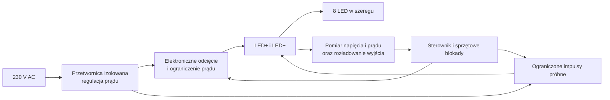

# Velluneo 2.0 · przegląd projektu zasilacza E27

Projekt dotyczy żarówki sieciowej z wymiennym wkładem. Aktualny wariant D5 przewiduje jedną płytkę zasilacza i jeden szereg ośmiu diod. Wkład ma dwa styki, LED+ i LED−, oraz włącza się automatycznie po podłączeniu sprawnego obciążenia. Docelowy prąd wynosi około 270 mA. Prąd, napięcie zimnego wkładu i bezpieczeństwo styków wymagają pomiarów.

## Aktualna płytka D5

Przewidziane 95 pozycji montażowych mieszczą się po obu stronach obrysu **70 × 34 mm**. KiCad nie zgłosił naruszeń w kontroli geometrii. Płytka przedstawia rozmieszczenie. Pola pozostawiono bez przypisanych sieci i ścieżek, a ostatnio analizowany układ czasowy wymaga sprawdzenia miejsca po wrysowaniu do schematu.

**Wierzch**

**Spód**. Trzypinowy element widoczny po lewej to rezerwa miejsca na dostęp serwisowy do programowania i pomiarów. Wkład korzysta z dwupinowego wyjścia J3.

[Plik płytki KiCad](../../outputs/Zasilacz_8S_D5_Studium/8S-D5-Studium.kicad_pcb) · [Raport kontroli geometrii](../../outputs/Zasilacz_8S_D5_Studium/DRC.rpt)

## Działanie wersji dwustykowej

- **Sprawny wkład.** Układ ma podać dwa ograniczone impulsy, ocenić odpowiedź obciążenia i stopniowo włączyć prąd roboczy.
- **Wyjęcie wkładu albo przerwanie szeregu.** Pomiar ma wykryć zanik prądu i uruchomić odcięcie oraz rozładowanie styków.
- **Zwarcie.** Wyjście ma odciąć pełne zasilanie. Kolejne ograniczone próby pozwalają wznowić pracę automatycznie po usunięciu usterki. Temperatura ma być monitorowana na płytce zasilacza.

[Decyzja o dwóch stykach i plan prób](driver-8s-two-contact.md) · [Bloki elektroniczne i dobór obudów](driver-8s-two-contact-circuit.md)

## Co wynika z obliczeń

- **Wykrywanie wkładu.** W badanym modelu różnica napięć między impulsami wyniosła najwyżej 0,881 V dla szeregu LED i co najmniej 3,753 V dla rezystora w badanym zakresie. Większa pojemność może zmienić odczyt. Wartości trzeba odnieść do pomiarów rzeczywistych diod i błędu toru pomiarowego.
- **Ograniczenie czasowe.** Kandydat sprzętowy wyznacza w obliczeniach okno 114–122 ms i co najmniej 542 ms przerwy między impulsami przy prawidłowej pracy układów czasowych. Trzeba zweryfikować zachowanie przy zaniku zasilania sterowania i uszkodzeniu przełącznika.
- **Wyjście dostępne dla użytkownika.** Cele projektu to maksymalnie 30 V DC z pikami w rozpatrywanych stanach pojedynczej awarii oraz spadek poniżej 5 V w 100 ms od odłączenia. Obliczenia i cele projektowe wymagają potwierdzenia pomiarem napięcia, prądu dotykowego, energii impulsów i izolacji od sieci.

[Obliczenia i dobór sprzętowego ograniczenia impulsów](driver-8s-probe-timing.md)

## Wersje do porównania

**D4** ma pełny roboczy schemat KiCad i wcześniejszą płytkę 70 × 34 mm. W tej wersji były dodatkowe styki do blokowania wkładu. Jej wyniki kontroli schematu i płytki dotyczą D4. [Schemat i podglądy D4](../../outputs/Zasilacz_8S_D4/README.md)

**Rev K + Rev H** to wcześniejsze dwie płytki zasilania i sterowania dla 16 LED w dwóch szeregach. W repozytorium jest też model wkładu 16 LED i wcześniejsza koncepcja mechaniczna. [Dwie płytki razem w 3D](../../outputs/Zasilacz_RevK_Moc/Podglady/Zasilacz_RevK_RevH_razem.png) · [Wkład 16 LED w 3D](../../outputs/Wklad_LED/Wklad_LED_3D.png) · [Koncepcja mechaniczna](../../outputs/Mechanizm_E27_RevA.svg)

## Do omówienia z mentorem

1. Jak najlepiej zmierzyć odpowiedź 8 LED przy małych prądach i odróżnić ją od innych obciążeń?
2. Jak zapewnić niezależne od sterownika odcięcie przy awarii, zwłaszcza gdy przełącznik sondy pozostanie zwarty?
3. Jakie próby izolacji i styków zaplanować przed pierwszym prototypem oraz jakie odstępy zarezerwować przed trasowaniem płytki pod JLCPCB?

Następny etap to pełny schemat dwustykowy, ponowny sprawdzian obrysu z nowymi elementami i pomiary zabezpieczeń. Dokument pokazuje stan projektowy przed przygotowaniem plików do zamówienia.
