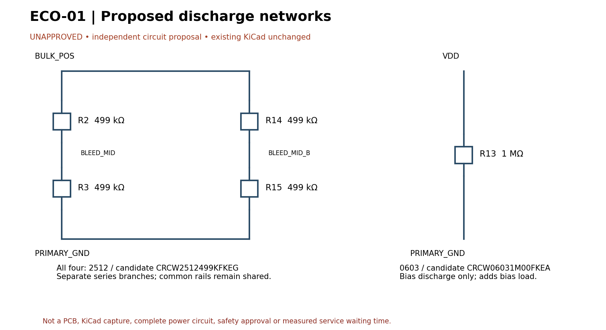

# ELEC-CLOSE-01 — electrical integration and discharge ECO review

2026-11-17. **Calculation/proposal packet; schematic stage remains incomplete.** Parent published commit bb28f9c81f902f3e9de92dfab5ac17fce0e75fb4. Existing accepted r12 scope and canonical approved28-position circuit are unchanged. No product PCB, routing, DRC, fabricated supply or physical measurement is created by this packet.

## Concrete engineering outcome

| Work | Actual result | Scope and remaining evidence |
|---|---|---|
| Bulk discharge fault review | Existing499k+499k1206 pair loses its dedicated passive path after one open; one short exposes remaining1206 to357.8V versus its200V working rating. | Real design weakness in this selected path, not a physical fault test or whole-product risk conclusion. |
| [ECO-01 proposal](ECO-01.md) | Four499k2512 resistors in two independent series branches, plus1Mohm VDD bleeder; numeric-reference migration;31positions/79pins/22nets/4NC. | [Proposed graph](proposed-connectivity.json) has approval=null. Not applied to native CAD. No supplier-stock confirmation. |
| Discharge calculations | Four-resistor corner model retains a passive path after one resistor open;357.8→5V passive-only bound78.33s at18uF. Single-short remaining2512 dissipates≤.2621W at high-line crest,≤.3276W at400V screen, conditional125°C limit. | These are isolated RC subcircuit calculations. Neither78.33s nor1.56s bias RC is an approved whole-lamp service wait; stored-energy transfer, other faults and cooling remain. |
| [Startup](startup/README.md) | Native TI family report establishes intended three-sampling-pulse cadence atfSW(max);128 ramp cases reproduced,768 residual-current hybrid cases executed. Conditional takeoverVDD11.5597V baseline/11.4938V with optionalRVDD. | Earlier blanket claim of no published cadence is corrected. No complete exact controller model, actual gate/bias trajectory or measured startup pass. RC-BIAS-001 remains open. |
| [Winding and actual window](magnetics/README.md) | CandidateP120/A22/S30,0.18mm primary/aux and TEX-E0.30mm secondary;10.5mm band×2.293mm radial build. Nominal core/bobbin solid intersections0mm³; dimension-only radial margin.207mm. | Leadouts, centering, assembly/tape tolerances, dielectric system and AC/core/aux loss remain. TEX-E0.40 nominal fit does not clear dimension-only tolerance screen. |
| Hot winding resistance | At assumed125°C/60mm mean turn length: Rp7.226Ω,Rs.706Ω; separate-maxima P+S DC loss~.2654W, peak drops2.591V/1.012V. | Need propagate finite resistance, AC effects and actual aux waveform into control/protection. Ideal-transformer results are not final hardware results. |
| Averaged input sweep |1152cases;49/50/51Hz,207/230/253Vac,6/8/10/11W constant remaining bus load,15uF±20%,bridge/R/source corners, old/new bleeders; half-step refinement performed. Proposed-bleed minbus255.735V, maxlineRMS.09923A, maxchargepeak.30511A. | Does not simulate the switching controller, startup, faults, surge, EMI or establish real power demand. SeriesR loss up to.5434W conservatively includes source resistance. |
| Input capacitor RMS | Conditional all-waveform triangle screen~.2006A against conservative all-band.152A allowance for existing15uF. | Inconclusive acceptance: conservative bound exceeds allowance. Need real/bounded spectrum and thermal assessment. It does not prove actual capacitor fails; no22uF upgrade selected. RC-INPUT-001 stays open. |
| Optical tolerance | Digitized native typical Cree G-class current curve; assumed218.763–289.194mA current screen gives flux-ratio1.2889 versus allowed850/750=1.1333. | Conditional counterexample to guaranteed light budget, not a measurement/all-unit failure.25°C curve scaled to85°C and diffuser.87 are hypotheses; exact bins/current/temp/optics require confirmation. |
| Native checks | Locked KiCad10.0.6 doctor and unchanged73-pin approved graph pass; ERC exits0 with no enabled findings. | These checks address old28-position native CAD, not the proposed31-position circuit. Requirements U05–U09 and full managed-configuration check still fail. |

## Product-direction recommendation

Keep architectureA and the present active-stage/15uF values while assessing the specific unresolved dynamics. Prepare the discharge/numeric-reference ECO as a distinct owner-reviewable delta. Keep0.30mm secondary as the geometrically better-supported winding candidate. Do not substitute a timing-independent resistor bias feed: the~2.68W high-line loss required by the stated full-bias assumption is unsuitable for this lamp power budget.

For the single4000K demonstration, propose factory-side LED-bin selection and measured current/flux calibration of the base/panel pair, with no user adjustment. This is a **proposal**, not permission to relax750–850lm, interchangeability, line/temperature behavior or the later three-colour family. A calibration at one point cannot establish all-corner regulation. The present calculation cannot guarantee the production family without tighter regulation/characterization; if calibration plus the existing controller cannot meet it, prepare a separate tighter-regulation architecture ECO. No active panel regulator is silently introduced. Warm8LED/neutral7LED/cool7LED numbers here remain optical screens, not a finalized panel BOM/interface.

## Draft panel/base electrical envelope (not a frozen interface)

J2.1 OUTPUT_POS, J2.2 OUTPUT_NEG are internal base wire terminations; existing pads are not the actual user-accessible mating dock. Normal target18–27V and≤300mA gives≤8.1W panel DC budget. Proposed normal operating budget is distinct from the actual OVP/fault/partial-contact limits. A proposed engineering open-panel fault-voltage ceiling is≤40V; it is illustrative and unapproved, pending the actual interface/safety review. It is separate from the accepted service-access goals≤5VDC/≤.5mJ and touched parts≤45°C, plus no damage/open/short recovery. Neither normal voltage nor an RC estimate proves those limits. Connector/keying/contact sequencing/material/force/durability and actual discharge/cool-down path remain unselected; U09 is not closed.

At panel solder-temperature goal85°C and ambient40°C, treating all8.1W as heat gives required path≤5.56K/W. Adding an **unverified proposed**2.5W base heat budget tightens a shared path to≤4.25K/W. These are feasibility budgets, not measured thermal resistance, material ratings or lifetime proof. The1.012V hot secondary peak IR drop and unresolved AC/core/aux losses must be included before accepting those budgets.

## Required next sequence and retained findings

1. Four distinct read-only roles inspect this same frozen proposal/calculations. They may recommend intent review only; unresolved major findings stop schematic acceptance.
2. Kamil reviews the exact ECO graph digest from proposal-check.json. A real decision is required before changing the independently approved physical pin graph. This is not approval of the schematic stage or manufacturing.
3. After approval, sole CAD writer updates graph/BOM/footprint assignments/native schematic for this ECO; re-export views, compare every physical pin, rerun ERC/requirements/work check. Old native results become historical for the altered source.
4. Continue actual controller/gate/aux dynamics and fault/SOA/clamp/short/OVP/NTC/line-surge work; propagate winding losses and resolve bulk-ripple acceptance and regulation/flux budget. RC-COMP-002,RC-MODEL-001,RC-CTRL-MODEL-001,RC-PROT-001 and all earlier service/thermal/safety majors remain open; this packet does not close them by relabeling calculations.
5. Freeze electrical/physical interface and complete schematic-stage evidence/configuration. Only after actual schematic-stage approval: independently reviewed spatial intent, placement/3D, routing/parity/DRC, release review. No order or physical test is authorized by this packet.

## Reproduction and evidence

- `python electrical-integration/calculate.py --cree-pdf EXTERNAL_CREE.pdf --crcw-pdf EXTERNAL_CRCW.pdf` from specification-reset or use full path. Requires PyMuPDF; full source SHA256 is asserted. Generates results.json and original numerical extraction of the native **typical** curve. Vendor full PDFs/curve images are not redistributed.
- `python electrical-integration/input-corners.py` requires NumPy and the pinned existing averaged model. Actual run~476s in this environment; coarse2us/refined1us,1152cases. Results include max refinement differences; no benefit is claimed from further repeating unchanged sweeps.
- `python electrical-integration/calculate-integration-limits.py` and `python electrical-integration/draw-proposal.py` reproduce conditional budget and original circuit illustration (Matplotlib).
- Startup/magnetics subfolders contain actual rerun commands, explicit external source inputs, source URLs/hashes, implementer identities and limitations.
- native-runs.json records exact locked commands/exit codes, including initial tool-lock rejection and sequential successful rerun where applicable. requirements-schematic.json/check-work.json are actual failures, not waived.
- proposal-check.json is internal proposed-graph/BOM/source-hash consistency only. The actual toolkit connectivity.json tests the unchanged approved graph. Do not confuse these checks.

See task-contract.md, findings.md and frozen-inputs.json for ownership, retained gates and exact frozen source scope. Reviews/integration records are lifecycle outputs excluded from their own input manifest to avoid hash cycles. No physical measurement was possible here; user/university instruments are not attached to this execution environment.
