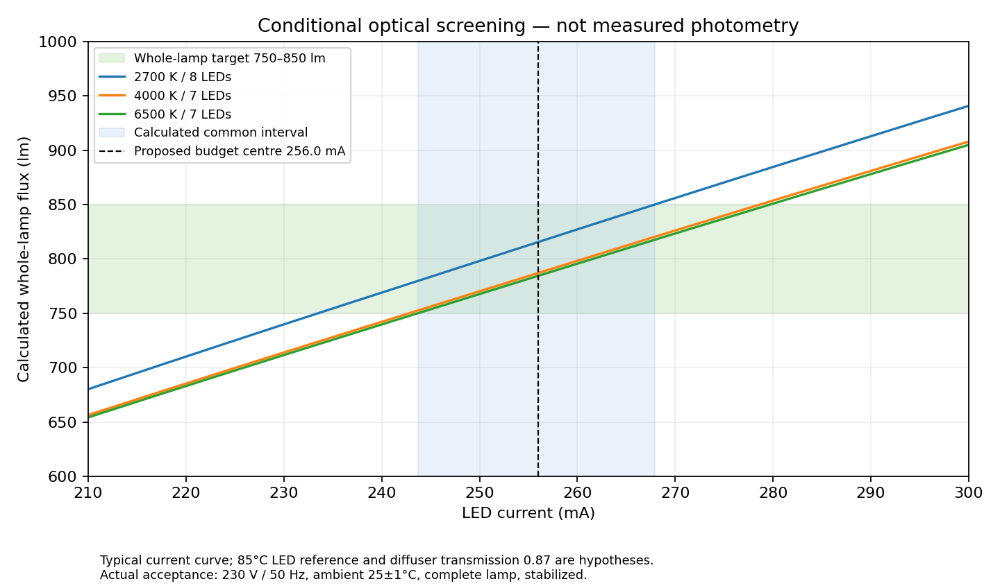

# Optical acceptance and common-current calibration budget

ELEC-REFINE-02,2026-11-17. Author/root. Calculations and proposed factory method only; no actual photometry, current setting, LED bin purchase or CAD change.

## Correct acceptance domain

Accepted requirements-and-plan.md r12 append-only scope at lines189–193 binds complete-lamp photometry to230Vac/50Hz,ambient25±1°C,base-up,complete milky diffuser fitted,at least30minutes and three5-minute-spaced readings differing<0.5%,extended untilstable. This is **not an approved750–850lm guarantee at every input/ambient corner**. Normal safe/functional operation at declared line/10–40°C/orientation corners remains required; no acceptance threshold is weakened here. Earlier full current/temperature/efficiency screens remain valid conditional counterexamples to an *uncalibrated family guarantee*, not proof that the single prototype fails nominal accepted photometry.

TI SLUSB86C p11Eq3/p19Eq14 explicitly includes etaXFMR for transformer delivery(core/winding,leakage,bias). It must not be removed from the design equation or double-counted after explicitly modeling those losses. The old0.85–0.95 interval and line-delay witnesses were hypotheses, not measured part variation or statistical confidence. Datasheet headline±5% is not a substitute for this exact converter's measured all-corner behavior.

## Actual calculation and engineering direction

Use the previously source-digitized typical Cree G-class curve, sourceSHA74d4261952c25e6833212a82b0f72e759f8297478627a368f4acff22378c92c8,LED reference85°C values and assumed diffuser transmission0.87. Reference85°C is a **junction/flux modeling hypothesis**, not the accepted25°C ambient or an actual measured junction temperature. Current/temperature separability and the curve are not guarantees; source order codes specify a minimum bin, not a guaranteedmaximum. Manufacturer±7% measurement tolerance is not a manufacturing-spread distribution.

| Calculated result | Value |
|---|---:|
| Unperturbed common current interval for750–850lm |243.703–267.915mA |
| Calculated family minimax centre |256.007mA |
|2700K,8LEDs at that centre |815.554lm |
|4000K,7LEDs at that centre |787.070lm |
|6500K,7LEDs at that centre |784.446lm |
| Nominal brightest/dimmest |1.03966 |

The±1%current and±1%totalstabilizedoptical-gain **proposed engineering budgets** give769.514–831.216lm and worst ratio1.08018, even allowing independent current variation with different panels/loads. For an illustrative expandeduncertaintyU=5lm this also yields an uncertainty-aware worst ratio~1.0938 and fluxguardband755–845lm. AtU=10lm the same1%/1% budget fails the uncertainty-aware matching check; tightening only the proposedcurrentbudget to±0.5% provides a conditional alternative. Neitherbudget norU=5/10lm has been achieved or approved as instrumentcapability. Actualuncertainty/correlation must come from the laboratory, not this example. The results.json100-case table reports both unguardedphysical ratios and (Fmax+U)/(Fmin−U) acceptance ratios, including failures for looser budgets; the singlecentre is insufficient.

The diagnostic sense value2.32025ohm follows only assumedVCCR.330V/eta.90/current256.007mA. **R9 remains2.37ohm in the actual KiCad circuit**. Existing nominal250mA screens give4000K~770lm, inside the accepted750–850 interval before unknown optics/bin/thermal effects. Do not automatically replaceR9 with2.32ohm based on assumed efficiency. Any actual resistor change needs its affected electrical/current/flux/clamp/startup recheck and source-bound ECO; increasing current is not free margin.

Keep architectureA and simple panels for P0. A complete-lamp factory calibration/selection step is a workable engineering route to assess the single first configuration without adding a regulator to everypanel. It removes no future common-base/no-user-setting/family requirement. It does not prove arbitraryfuturepanel/base interchangeability or all-line/temp/life behavior; those still need controlled component bins/process and characterization. No new active-panel regulator, transformer, current resistor or optical requirement is silently selected.

## Proposed factory/laboratory assessment, not measured evidence

1. Bind the actual base/panel/diffuser revisions, exactLEDreel/bin, fixture/orientation and calibrated instruments/uncertainty. Perform electrical safety/thermal readiness checks through the responsible laboratory personnel before actual powered work; this document is an optical method, not permission to energize a draft supply.
2. Under accepted230V50Hz/25±1°C/base-up conditions, use the complete lamp and wait for the prescribed stabilization. Record actualLEDcurrent/flux/CCT/Ra and temperatures; do not substitute the current curve for the actual complete-lamp measurement. Use actual expandeduncertaintyU to require flux>=750+U and<=850−U. IfU>50lm the interval is empty; atU=50lm it is the singleton[800,800]with zero practicalguard margin. Suchuncertainty leaves no useful productionacceptance margin; the setup needs improvement. CCT/Ra use the acceptedlimits and the laboratory's actual uncertainty; current budget alone cannotpass them.
3. For one P0-4000 configuration, first assess the unchanged2.37ohm build. If actualflux meets the guardband, no current-value change is needed. If it does not, diagnose LEDbin/diffuser/thermal/current causes before selecting and reviewing a current-resistor correction. No made-up measurement row is supplied and no such measurement has been run.
4. For FAMILY-3, obtain actual stabilizedflux-versus-current functions F2700(I),F4000(I),F6500(I) on the *same base* and intendedcompleteassembly. Find a common admissiblecurrent interval where each meets750+Ui..850−Ui and the uncertainty-aware brightest/dimmest ratio<=1.10. Account for actualcurrent changes when a different panel/load is fitted. The factory mayselectLEDs or calibrate thebase; the enduser never changes settings. One passing4000K panel cannot passFAMILY-3.
5. Assess relevant input/thermal/hot-start/fault behavior separately; reverify affected limits after any factorytrim. Record sample/revision/rawdata/uncertainty and identify evidence as measured only when real files exist. The single prototype and100h screen do not establish production tolerance or15000hL70.

Replay:`python calculate.py`(NumPy/SciPy),then`python plot.py`(Matplotlib). Inputs are repository-relative and hashed. No supplierfullPDF/image is redistributed; plotteddata is the previously digitized typicalcurve plus original calculations. No proposal is copied into acceptedrequirements.json or the physical-pin graph.
