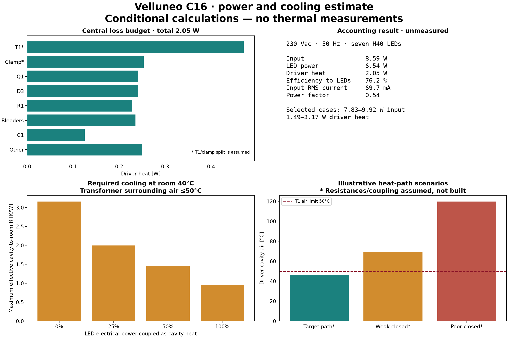

# POWER20 - input power, efficiency and cooling

Analytical C16/LED19 assessment, 21 November2026. **Calculated scenarios, no
measurements or guaranteed upper loss/temperature bounds.** No CAD/BOM change.

## Practical result

For seven Cree H40/4000K LEDs, nominal230Vac50Hz, assumed transformer accounting
eta=.90 and central loss assumptions:

- Input **8.59W**, total DC output **6.58W**.
- LEDs receive **6.54W** at **20.64V / 316.9mA**.
- Heat generated by the driver including its bleeders: **2.05W**.
- Efficiency to LEDs **76.2%**; to total DCoutput
  **76.7%**. Neither is90%.
- Modeled true RMS input **69.7mA**, PF**0.54**.
  The charging current is pulsed; real watts/Vrms alone would understate RMS.

C1 ESR heats the capacitor in the accounting but is omitted from the charging
waveform impedance. RMS/PF are first-order estimates, not validated waveforms.

The controller's319mA includes the10k output bleeder. About2.06mA goes there,
leaving316.94mA for LEDs. LED19's319mA LED result remains an explicitly approximate
historical point; this packet corrects power accounting without altering R9.

Across **97 selected cases** (207/230/253Vac, transformer
eta.85/.90/.93, existing controller/Rcs corners, loss presets, selected cold/hot
voltage references): input**7.83..9.92W**,
driver heat**1.49..3.17W**,
LED efficiency**67.7..81.3%**,
inputRMS**61.3..83.9mA**.
These are sensitivity extrema, NOT guaranteed or statistical bounds. Unknown MYRRA
losses, actual switching and temperature/age-dependent ESR may move them further.

## Loss distribution at the nominal modeled point

| Component/group | W | Evidence |
|---|---:|---|
| R1 | 0.229 | Conditional accounting; method below |
| F1 | 0.022 | Conditional accounting; method below |
| BR1 | 0.037 | Conditional accounting; method below |
| C1 | 0.125 | Conditional accounting; method below |
| bulk_bleeders_R2_R3_R14_R15 | 0.193 | Conditional accounting; method below |
| startup_R16_R17 | 0.111 | Conditional accounting; method below |
| Q1 | 0.241 | Conditional accounting; method below |
| R9 | 0.012 | Conditional accounting; method below |
| T1_assumed_allocation | 0.471 | Assumed split within eta allowance |
| D1_TVS1_assumed_allocation | 0.253 | Assumed split within eta allowance |
| U1_aux_gate_R10_R13_VS_network | 0.041 | Conditional accounting; method below |
| D3 | 0.241 | Conditional accounting; method below |
| C4 | 0.026 | Conditional accounting; method below |
| output_bleeders_R11_R12 | 0.043 | Conditional accounting; method below |

T1 and D1/TVS1 shares cannot be determined uniquely from the public datasheet.
Their central0.471/0.253W
split is an assumption, not a manufacturer prediction. Bias is inside the same
eta allowance and is not added again. [Method and every assumption](method-and-assumptions.md).

## What cooling is required

MYRRA specifies surrounding air<=50C. At room40C only10K cavity-air rise is
available. Using the selected-case largest driver heat3.17W
and largest LED electrical power7.36W with zero optical
heat credit, the effective cavity-to-room requirement is:

| LED heat entering driver cavity | Required Rair at40C, K/W |
|---|---:|
| 0% | <=3.16 |
| 25% | <=2.00 |
| 50% | <=1.46 |
| 100% | <=0.95 |

These are required effective paths, not achieved resistances or a radiator size.
Use thermal separation from the LED carrier and a qualified insulated conduction
path to housing, or verified ventilation. A printed shell may be mechanical
support, but its material/walls/vents do not yet establish adequate cooling.
Recirculating air within a closed shell does not reject heat to the room. Existing
isolation/fire/mechanical requirements remain. No fan or large radiator is selected.

## Conditional temperatures

The following estimates assume a target cavity path3K/W, board-to-cavity8K/W,
zero LED coupling, and the explicit local resistances in the method. **This path
has not been built or measured.** Board/case/air are different nodes. Values are
not actual C16 temperature predictions independent of cooling geometry.

| Component/node | Central at room25C | Central at room40C | Selected max-heat case at room40C |
|---|---:|---:|---:|
| T1 surrounding air | 31.1C | 46.1C | 49.5C |
| Board common node | 47.5C | 62.5C | 74.9C |
| Q1_junction | 53.3C | 68.3C | 90.2C |
| D3_junction | 54.7C | 69.7C | 82.5C |
| U1_aux_junction_upper_allocation | 49.3C | 64.3C | 77.1C |
| T1_hotspot_UNCALIBRATED | 66.3C | 81.3C | 98.5C |
| C1_internal_UNCALIBRATED | 57.5C | 72.5C | 98.5C |
| C4_internal_UNCALIBRATED | 50.6C | 65.6C | 77.6C |
| R1_hotspot_UNCALIBRATED | 53.2C | 68.2C | 83.0C |
| BR1_junction_UNCALIBRATED | 48.6C | 63.6C | 76.9C |
| TVS_D1_hotspot_UNCALIBRATED | 60.2C | 75.2C | 104.4C |

T1/capacitor/resistor/bridge/clamp internal local resistances are UNKNOWN and
their displayed values are illustrative assumptions. Q1 uses source4.2K/W
junction-to-case plus assumed20K/W case-to-board. D3 uses source30K/W to an
assumed board-temperature lead. U1 uses thetaJB44.4 as a reference-condition
screen, not an extracted thermal path; all auxiliary-group heat is assigned to it.
Actual T1 winding/core and capacitor internal temperatures remain unestablished.

The third column is the maximum TOTAL driver-heat case, not a per-component
temperature envelope. For example another selected case reaches102.4C for the
assumed T1 hotspot under the same target path;98.5C is not its selected-case maximum.
Even this guessed path gives C1~98.5C in the high-heat case, above the tentative85C
reserve goal. Passing the50C transformer-air condition does not close component
cooling or lifetime requirements.

The weak/poor closed-path scenarios in results.json exceed the transformer AIR
limit at room40C; they are rejected scenarios, not proof a particular shell fails.
Conversely the target scenario passing50C is not proof this path is achievable.
The maximum driver-heat and LED-heat cases need not be the same electrical case.

## Reproduction, evidence and retained holds

Run `python calculate.py` (standard library only). Results include every selected
case, independent line-source energy residual, output-charge residual and a
nominal4us-to2us timestep check. This checks numerical/accounting consistency,
not physical correctness. `render_report.py` uses Matplotlib only for the chart.

[Exact sources](sources.json), [input hashes/preserved prior files](input-binding.json),
[measurement plan](measurement-plan.md), [toolkit doctor](toolkit-doctor.json),
[review and integration](integration-record.md). Doctor passed with explicit
KiCad10.0.6 CLI/pcbnew; default-path probes found another version and were rejected.
No tool/configuration migration or new ERC/DRC/release pass is claimed: no CAD
changed and prior production sources are hash checked. The17C17 physical/process/
human holds and C16 fault/clamp/thermal/isolation/assembly conditions remain.

Next practical cooling decision needs actual enclosure heat paths and coupled
driver/LED thermal measurements. This packet supplies a heat budget and cooling
targets; it does not authorize manufacturing or infer completed thermal/life tests.
